# Triqual

<p align="center"></p>

<p align="center"><b>A working method for AI coding agents</b>: a plan before the code, a review for every task, and a live run board.</p>


Triqual is a Claude Code plugin marketplace (`triqual`) that gives an AI coding agent a working method: a plan before
the code, a review for every task, a progress log it cannot skip, and guards on the scripts it runs. One command
installs it and keeps it in sync across Claude Code, Codex and Grok.

It is for developers who run an agent on multi-step work and want the result to stay verifiable: what was planned,
what was done, who reviewed it and what was run.

triqual's methodology began as a fork of [superpowers](https://github.com/obra/superpowers) by Jesse Vincent (MIT). It has since been rewritten as triqual's own orchestrator; thanks to Jesse for the foundation.

- **Workflow skills** (`methodology`): brainstorm, plan, execute through role subagents with a review sized by each
  task's tier, review code and finish, plus the global rules that `triqual sync` writes into `~/.claude/CLAUDE.md`.
- **Strict progress tracking** (`progress-tracking`): one log entry per task and a task ledger per plan, enforced by
  hooks and a git `pre-commit`. The tracking lives in the repo, hidden under `.git/`, or in a local database outside it.
- **Role agents** (`roles`): nine agents (implementers, reviewers, a fixer, a brief writer, a hunter and a phase
  orchestrator), each on the model tier that fits its job.
- **A Workflow guard** (`workflow-gate`): caps the agents a Workflow script launches per model (Fable 3, Opus 8, Sonnet 12,
  Haiku unlimited), and the same-model agents a session starts through the `Agent` tool within 120 seconds.
- **A weekly memory report** (`memory-report`, optional): a local health report on the claude-mem memory.

Since 0.6.0 the methodology executes a plan as a stack: a plan is a sequence of phases and each phase is one branch
and one pull request (phase = branch = PR), made of tasks that are one commit each (task = commit).
`executing-plans`, the one orchestrator, builds the stack with `stack.mjs`: in GitHub mode (a GitHub remote
and `gh stack`) it pushes the phase branches, opens and updates draft PRs and marks them ready for review after the final
review, and otherwise the branches stay local.
Confirming the plan at the `writing-plans` handoff authorizes that push of the plan's phase branches and draft PRs, and marking them ready for review after the
final review, nothing else, and merging stays yours.
Committed tracking mode is not supported by the stacked execution, because every ledger move would dirty the tree:
switch the repo with `triqual progress-init --store` or `--local` first.

## Quick start

In Claude Code:

```text
/plugin marketplace add Montinou/triqual
/plugin install methodology@triqual
/methodology:setup
/reload-plugins
```

It needs Node 22.13 or newer, git 2.31 or newer and the `claude` CLI. Installing `methodology` brings in the other
three system plugins, `/methodology:setup` finishes the machine-level setup, and `/reload-plugins` loads what it
installed into the session you are in (or start a new session). A SessionStart hook then loads the methodology on its
own. Codex, Grok and the `language` question need a terminal: `npx triqual setup` below, or the clone in
[Install](#install).

From a terminal (from triqual 0.1.0 on npm), the same setup plus Codex, Grok and the `language` question, with no
clone:

```bash
npx triqual setup
```

It adds the marketplace and installs `methodology` through the `claude` CLI, then runs the installer that plugin
ships. See the [triqual package](packages/triqual/README.md) for its flags and exit codes.

### What `bootstrap` changes on your machine

`/methodology:setup` runs the same installer as the full setup, minus the `language` question and the Codex and Grok
step. It changes this, and is safe to rerun:

- Installs `methodology`, `progress-tracking`, `roles` and `workflow-gate` at user scope, and updates any whose
  installed version differs from the marketplace's.
- Writes the `triqual` command and the hook launcher into `~/.local/bin/`.
- Writes the global rules into a managed section of `~/.claude/CLAUDE.md`, and disables any `superpowers@*` plugin,
  which `methodology` replaces.
- Edits `~/.claude/settings.json`: the allow rule `Bash(triqual tracking:*)`, added without a prompt because the command passes `--yes`.
- Backs up every file under `~/.claude` that it edits or removes into `~/.claude/backups/triqual-<YYYYMMDD-HHMMSS>/`.
- On a machine set up by an older release: runs `triqual migrate` first, then removes the legacy copies of the role
  agents in `~/.claude/agents` and the legacy Workflow gate hook (skipped while the rules section still fails its
  check). See [Install](#install), steps 2 and 6.

The full setup from a terminal (`npx triqual setup` or the clone) also removes the `language` key from
`settings.json` after asking, and sets up Codex and Grok when it finds them.

## Plugins

Each plugin has its own reference page with every command, flag, file and environment variable:
[methodology](plugins/methodology/README.md), [progress-tracking](plugins/progress-tracking/README.md),
[workflow-gate](plugins/workflow-gate/README.md), [roles](plugins/roles/README.md),
[memory-report](plugins/memory-report/README.md), and the Codex bridge
[methodology-codex](plugins/methodology-codex/README.md) (0.2.0, listed only in the Codex marketplace; see
[Codex and Grok](#codex-and-grok)).

**npm packages.** [`triqual`](packages/triqual/README.md) installs and runs triqual from a terminal (`npx triqual
setup`). [`@triqual/headjack`](https://github.com/Montinou/headjack#readme) ships Headjack's CLI and stdio MCP server.
Both publish from tagged releases through npm trusted publishing, with provenance.

| Plugin | Version | What it ships |
|---|---|---|
| `methodology` | 1.6.0 | The core, and the `/methodology:setup` command that finishes the machine-level setup after a marketplace install. The global rules (`rules/global.md`) that `triqual sync` writes into a managed section of `~/.claude/CLAUDE.md`; the eleven workflow skills (`methodology:brainstorming`, `writing-plans`, `executing-plans` and the rest, listed under [Skills](#skills)), wired to the role agents, the task ledger and progress tracking, and superseding `superpowers@*`, which `triqual sync` disables; `triqual sync`, `triqual doctor` (`triqual doctor --repo` also checks the current repo's tracking: its git gate in committed, local or store mode, and `triqual tasks check` drift), `triqual migrate`, `triqual role-eval`, `triqual cost`, `triqual suggest` and `triqual hook`; a SessionStart hook that injects `methodology:using-methodology` and notices when that section drifts from the installed rules or a superseded plugin is still enabled; and, since 0.3.0, the same methodology in Codex and Grok (`triqual hook`, `triqual sync --harness <id>`, see [Codex and Grok](#codex-and-grok)). Depends on the other three plugins, so installing it installs them. |
| `progress-tracking` | 0.7.2 | `progress.md` (one entry per task) and `status.md` (overall state) kept current, plus a task ledger per plan (`docs/plans/<plan>.tasks.json`) that `triqual tasks` drives and renders into `status.md`: the `progress-tracking` skill, the `/progress-tracking:progress-init` command (also `triqual progress-init`), a SessionStart hook that injects the current state, a Stop hook that refuses to end a turn with changes but no `progress.md` entry, and a per-repo git `pre-commit` that requires both `progress.md` and `status.md` staged in any commit with other changes. Committed mode keeps the files in the repo; local mode (`triqual progress-init --local`, for shared team or client repos) keeps them under `<git-common-dir>/methodology/`, never committed; there the files are written through `triqual tracking write`, since Claude Code refuses an agent's file writes under `.git/`. Since 0.4.0 a third mode, store mode (`triqual progress-init --store`), keeps the entries, status and task ledgers in a local SQLite database outside the repo, for repositories whose history must carry no tracking (see [Store mode](#store-mode)); it needs Node 22.13 or newer, and `triqual tracking status` and `triqual tracking log` read it back; since 0.4.1 `triqual tracking relocate <old-root>` follows a checkout that moved to a new place. Since 0.5.0 each task carries a declared and an effective review tier (`heavy`, `standard` or `light`): the plan's `**Tier:**` line, all or none of a plan's tasks, and `triqual tasks retier`, which only raises. Also `triqual tasks line` for the status line and `triqual ui`, a local read-only dashboard (the run board since 0.6.0). The hooks only act in opted-in repos. Since 0.2.3 the SessionStart context fits a character budget (`gate.mjs session-start --budget <n>`), so Codex and Grok can share one context with the methodology. Since 0.7.0 the live Agents panel shows session trees and tool feeds with optional notes on port 47800. Six async recorder hooks (`SessionStart`, `SubagentStart`, `SubagentStop`, `PostToolUse`, `PostToolUseFailure`, `SessionEnd`) write only ids and safe labels to `sessions.db`; `TRIQUAL_SESSIONS=0` disables recording. A synchronous hook harness, such as the Grok compatibility layer, pays about 120 ms per event. Roll out with `triqual sync --yes`, `triqual doctor`, then `/reload-plugins`. |
| `workflow-gate` | 0.3.3 | A PreToolUse hook that caps the agents a Workflow script launches per model: Fable 3, Opus 8, Sonnet 12, Haiku unlimited. Each `agent()` needs a `roles:*` agentType or a `model:`, the script declares `// MAX_AGENTS: fable=N opus=N sonnet=N`, and a non-Haiku fan-out over a dynamic list needs `.slice(0, N)`. A denial lists every problem with its fix. Since 0.3.0 a second `PreToolUse` hook on the `Agent` and `Task` tools, which is how the role agents are dispatched, caps same-model starts per session: a start is denied when that many agents of its model already started in the last 120 s (`WORKFLOW_GATE_AGENT_WINDOW_S`), with the same caps and `WORKFLOW_MAX_*` overrides. Haiku is never denied, and starts whose model cannot be resolved are counted apart, in their own bucket, capped at the Opus cap. |
| `roles` | 0.6.0 | Nine role agents for plan execution, dispatched as `roles:<name>`: `brief-writer`, `tdd-implementer`, `complex-implementer`, `safety-reviewer`, `spec-reviewer`, `review-fixer`, `final-adversarial-reviewer`, `hunter`, `phase-orchestrator`. Haiku hunts candidates; Sonnet writes briefs, implements, fixes, runs the safety gate and, as `phase-orchestrator`, runs one plan phase by dispatching the others (the only role that may dispatch agents); Opus runs the spec review, the final review and the tasks a plan marks `roles:complex-implementer`, which are always in the heaviest review tier. |
| `memory-report` | 0.5.0 | Optional; not a dependency of `methodology`, install it with `claude plugin install memory-report@triqual`. A weekly local report on the health of the claude-mem memory (hygiene, storage and growth, Chroma health, and the review tiers of the week from `triqual role-eval summary --by-tier`) plus LLM insights (proposed rules, skill changes, stale notes) drawn only from the entries you allowlist with `triqual memory allow`: a name (`acme`), a repository (`github.com/acme/app`) or an owner (`github.com/acme/*`, which covers that owner's repositories, future ones too; an Azure DevOps `<org>.visualstudio.com` owner is stored as `dev.azure.com/<org>/*`), where a pasted URL is normalized and a project is covered by repository only when its folders show unambiguous evidence; the never-send list takes the same three kinds; the insights stay off until you run the setup (skill `memory-report:setup`, or `triqual memory setup`), and `triqual memory allow` alone does not turn them on. `triqual memory repos` shows each project's repositories, the owners and the merge suggestions, which are printed and never run. A SessionStart hook generates it lazily in the background and shows one line until you read it with `triqual memory report`. Needs claude-mem installed and the `claude` CLI on `PATH` (the insights are one headless `claude -p` call). The generator, `triqual memory setup --suggest` and `triqual memory repos` read the claude-mem database and need Node 22.16 or later; the hook and the commands that only edit lists or print the state run on the 22.13 floor. |
| `headjack` | external | Optional, and not in this repository: [Headjack](https://github.com/Montinou/headjack) is the vault for agent skills, listed in this marketplace as an external plugin. Install it with `claude plugin install headjack@triqual`. Headjack sets its own version, so an installed copy updates only when Headjack bumps the `version` in its `plugin.json`. Its local mode needs Node 22.16 or newer (the 22.13 floor above is Triqual's own). Its launcher is `cli/headjack`, and the plugin puts nothing on your terminal's `PATH`: to run it from a terminal or from Codex, link `cli/headjack` from a clone of the [Headjack repository](https://github.com/Montinou/headjack) into `~/.local/bin` (see its README), not from the installed plugin's directory, which changes on every update. |

## Skills

`methodology` ships eleven skills. Claude Code names them `methodology:<name>`, and a SessionStart hook loads
`using-methodology`, which says when to invoke the others.

| Skill | What it does |
|---|---|
| `using-methodology` | The entry point of every conversation: find the skill that fits and invoke it before any response. |
| `brainstorming` | Explore intent, requirements and design before any creative work, and audit the resulting spec. |
| `writing-plans` | Turn a spec into a plan of phases and tasks. Every task carries a `**Tier:**`, a `**Role:**` and test-first steps. |
| `executing-plans` | The one orchestrator: dispatches a role agent for every task, reviews it by its tier and builds one stacked branch and draft PR per phase. |
| `test-driven-development` | The failing test first, for any feature or bugfix. |
| `verification-before-completion` | Run the verification commands and read their output before claiming work is done. |
| `systematic-debugging` | Find the cause of a bug or a failing test before proposing a fix. |
| `reviewing-code` | Review a commit range or a pull request outside a plan, and act on review feedback. |
| `finishing-branch` | Close the plan and decide how to integrate the work. |
| `diagnosing-methodology` | Find out why a session that ran these skills went wrong, or build a bug report for this repository. |
| `auditing-performance` | Audit the cost, speed and review yield of the plugins and roles from the machine's own records, publish the report, and feed the gaps back into the skill. |

Six skills of 0.x are gone. The old orchestrator skill became `executing-plans`, and the old inline `executing-plans`
is removed with it. `requesting-code-review` and `receiving-code-review` were merged into `reviewing-code`.
`using-git-worktrees` is now a section of `executing-plans`, `dispatching-parallel-agents` is covered by the global
rules, and `writing-skills` and skill finding moved to Headjack (`headjack:writing-skills`, `headjack:skill-finder`).
The [CHANGELOG](CHANGELOG.md) has the full list.

### How a plan runs

- **Subagents only.** Plans run only through subagents. A role agent (`roles:tdd-implementer`, or
  `roles:complex-implementer` for the tasks that need it) does every task. The one exception is a `coordinator` task,
  which is `light` in a tiered plan (in a tierless plan it stays at least `standard`, because no tier is lowered). The
  phase orchestrator runs a coordinator task that edits no file; one that edits files goes back to the main session,
  after the orchestrator ends its phase with `BLOCKED: coordinator task T<N> — edits files, run it in the main
  session`. A harness that cannot dispatch a named agent, Grok, stops and asks.
- **A thin main session.** For each phase the main session dispatches one `roles:phase-orchestrator`, waits for it and
  reads its summary, at most 20 lines. It reads no code, diff or report. The orchestrator runs the phase's task loop
  with three scripts: `task-open` starts a task (the ledger move, the brief, the BASE), `task-prep` prepares its
  review (tier check, hunters, review package) and `task-close` squashes it and records the review. When the orchestrator
  cannot be dispatched (a `roles` plugin too old to have it) or cannot dispatch the task agents (Codex with
  `[agents] max_depth` below 2), the main session says so in one line and runs that phase's loop itself. That fallback
  is announced and is not a stop.
- **Parallel tasks.** Independent tasks of a phase are built at the same time, at most 3 implementers at once. A task
  is independent when the tasks it depends on are complete and its `**Files:**` share no path with an earlier task of
  the phase that has not closed. One task works in the main checkout; each other one works in
  `.claude/worktrees/<plan stem>-t<N>`, made by `task-open --worktree`. Worktree tasks land on the phase branch in
  plan order, after their review, and the plan's `Test:` files run at the landing. A merge conflict or a failing
  `Test:` file is undone, never patched, and the task runs again sequentially. Nothing runs in parallel across phases,
  and a parallel run needs store or local tracking mode (`stack.mjs init` refuses committed mode).
- **Every task follows TDD.** A task that changes behavior starts with a failing test, in any tier; a task that
  changes none records the real output of its verification command instead.
- **A stack.** Each phase is one branch (and in GitHub mode one draft PR), each task one commit. `stack.mjs` (see the
  [methodology page](plugins/methodology/README.md#stackmjs)) owns the git and `gh` work. Each phase gets a deep
  review before it is submitted: 3 hunters and one `roles:final-adversarial-reviewer` over the phase diff, with at most
  two fix rounds. The final review of the whole stack then runs for every plan: for a plan with several phases it is a
  seams review, one `roles:final-adversarial-reviewer` and no hunters, that looks only at what one phase exposes and a
  later one consumes (in a single-phase plan the phase review is the final review). A `/clear` break follows every phase
  but the last, and the controller reads only the plan, the spec's Units and the current slice. Merging stays yours. A
  worktree for the whole plan is made only when you ask for one; the task worktrees of parallel tasks need no request.
- **Review by tier.** The plan declares a tier for each task; `tier-check` reads the task's real diff and raises it
  when the diff needs more. The tier is never lowered: not by the controller, not by a reviewer, not on request.

  | Tier | Round 1 | Round 2 | After a fix |
  |---|---|---|---|
  | `heavy` | 2 hunters (correctness, and security or state, picked from the task's heavy reason line) and the safety gate | `roles:spec-reviewer` on every candidate and the spec fit | scoped re-review by the roles that raised the findings, always |
  | `standard` | the safety gate and `roles:spec-reviewer`, in parallel; no hunters | none: the spec review ran with the gate | scoped re-review, except a fix that applies an approved ruling verbatim and touches no security logic |
  | `light` | the safety gate | none, unless the gate reports a finding or `Cannot verify` (then `roles:spec-reviewer` runs on that item) | the gate re-checks |

  `tier-check` raises a task to `heavy` when its diff touches a sensitive path (by default `**/hooks/**`,
  `**/setup/**`, `**/*schema*`, `**/migrations/**`, `**/drizzle/**`, `.github/**`, `plugins/workflow-gate/**`, plus the
  plan's `**Sensitive paths:**`), changes more than 300 lines (added plus removed), or has a binary change whose lines
  cannot be counted. It raises a `light` task to `standard` when the diff goes beyond the light allowance. Light stays
  light for Markdown outside the excluded classes (`**/skills/**`, `**/agents/**`, `**/rules/**`, `**/commands/**`,
  `**/templates/**`, `**/*-prompt.md`, `**/CLAUDE*.md`, `**/AGENTS*.md`; a new Markdown file stays light) and for JSON
  whose only changed key is `version`. Other files stay light while together they add or remove at most 20 lines (test
  lines count), create no file and change no binary file; a new test file is a raise, cases added to an existing test file are not. Lockfiles
  are never light. A plan with no tiers (written before 1.0) reads every
  task as `standard`, and the orchestrator raises tasks by a rubric at setup. In an opted-in repo a raise is
  recorded with `triqual tasks retier`, which refuses a lowering. Each completed task leaves a
  `task-review` record in `triqual role-eval`, and `triqual role-eval summary --by-tier` shows whether the weights are
  right.
- **Batched light dispatch.** Consecutive `light` tasks of one phase for `roles:tdd-implementer` resume the same
  implementer, one task at a time, with the review, squash and ledger move still per task.
- **Fence.** When fence is installed, the orchestrator cooperates with it. It detects fence once, leaves the skill
  installs it would otherwise do to the human, and treats a denial as a stop to report, never a call to retry in
  another form.

Codex runs the same skills with the role agents `triqual sync` generates. Grok has the skills but cannot run plans (see
[Codex and Grok](#codex-and-grok)).

## Install

The [Quick start](#quick-start) is the marketplace path, and `npx triqual setup` its terminal form. This is the same
full setup from a clone: it runs everything
`/methodology:setup` does and also sets up Codex and Grok and asks about the `language` key in
`~/.claude/settings.json`, which the command leaves alone.

Requires Node 22.13 or newer (the CLI and hooks; store mode's database is `node:sqlite`, which that release made available without a flag), git 2.31 or newer (progress tracking reads `git rev-parse --path-format=absolute`) and the
`claude` CLI.

```bash
git clone https://github.com/Montinou/triqual.git triqual
cd triqual
node bin/bootstrap.mjs
```

Bootstrap runs these steps in order and prints one line per step (`done`, `already`, `skipped` or `failed`); it
exits 1 when any step failed. It is safe to rerun.

1. Checks the prerequisites: Node 22.13 or newer (major and minor are compared, so 22.12 is refused), `claude` and git
   (`headjack` is optional).
2. Runs `triqual migrate` from this clone: a machine that still has the previous marketplace name moves to `triqual`
   first (see "Moving from the previous name" below); a fresh machine has nothing to migrate.
3. Adds the `triqual` marketplace at user scope, or updates it when it is already known.
4. Installs `methodology@triqual` at user scope, which brings in the other three plugins; then installs
   any of the four still missing and updates any whose installed version differs from the marketplace's.
5. Copies the `triqual` shim to `~/.local/bin/triqual.mjs` and links `~/.local/bin/triqual` to it (put `~/.local/bin`
   on your `PATH`), and copies the hook launcher to `~/.local/bin/triqual-hook` (used by Codex and Grok). On a machine
   that had the old CLI, for one release it also installs the deprecated `cm` alias (`~/.local/bin/cm.mjs` and the `cm`
   link) and the `cm-hook` forwarder, so callers of the old names keep working; `cm` prints a deprecation line (the `cm-hook` forwarder is silent). A
   machine that never had the old CLI gets neither.
6. Migrates an older manual setup: syncs the rules into `~/.claude/CLAUDE.md` (it refuses while rules from the old
   layout still sit outside the managed section); once they are synced, removes copies of the role agents and the
   Workflow gate hook that the plugins now provide; disables every `superpowers@*` plugin at user scope through
   `triqual sync` (the `supersedes` line); sets up the methodology in each detected harness (Codex, Grok: its home dir
   or its binary on `PATH`) through `triqual sync --harness <id>` (the `harnesses` line, one line per harness step before
   it), asking once for a harness `config.json` does not record yet and re-syncing a recorded one without asking; and
   removes the `language` key from `~/.claude/settings.json` after asking.
7. Adds the allow rule `Bash(triqual tracking:*)` to `permissions.allow` in `~/.claude/settings.json` after asking
   (the `tracking-permission` line), so `triqual tracking write`, `add`, `status` and `log` run without a permission
   prompt; `Bash(triqual:*)` already there counts as covering it. A rule for the `cm` alias does not, and neither does
   the narrower `Bash(triqual tracking write:*)` an earlier bootstrap added: both are kept, and the new rule goes
   beside them.
8. Runs `triqual doctor`. Right after Codex is set up for the first time this step fails, and bootstrap exits 1,
   until you approve the two bridge hooks in Codex (see [Codex and Grok](#codex-and-grok)).

Every file under `~/.claude` that bootstrap itself edits or removes is backed up first, into
`~/.claude/backups/triqual-<YYYYMMDD-HHMMSS>/` (one directory per run); the `claude plugin` commands it runs
change `~/.claude/plugins/` and `enabledPlugins` on their own. A legacy file is removed only when its content matches
a known released version.

Flags:

- `--yes` answers yes to every confirmation. Without it, confirmations need a terminal; when stdin or stdout is not
  a terminal they are refused and the step is skipped. The one-time split of an older `~/.codex/AGENTS.md` is never
  accepted by `--yes`: the `harnesses` line then names the command to run on a terminal, `triqual sync --harness codex`.
- `--keep-language` keeps the `language` key in `settings.json` without asking.
- `--no-harness` skips the `harnesses` step: no harness is detected, set up or recorded.

Bootstrap ignores flags it does not know.

## `triqual` commands

`triqual` runs a command from the installed plugin that owns it. It exits 3 when the plugin or command is not installed,
and 1 on an unknown command (it then prints the command list on stderr) or when the command cannot be started;
otherwise it exits with the command's own status (1 when checks failed).

`triqual --help` (also `triqual`, `triqual help` or `triqual -h`) lists every command with a one-line description and, beneath it, that
command's installed usage; a command that does not resolve is marked `(not installed)`, `(not released yet)`,
`(update <plugin> to get it)` or `(not in the installed <plugin> <version>)`. For one command,
`triqual <command> --help` or `triqual help <command>` prints its usage and flags and does nothing else (`triqual sync --help` writes
nothing). `triqual doctor`, `triqual sync`, `triqual migrate` and `triqual role-eval` refuse
unknown arguments with exit 2. Installs older than methodology 0.1.2 or
progress-tracking 0.2.1 ignore `--help`, so `triqual` never passes it to them (`triqual tracking --help` needs progress-tracking
0.2.2, the release that ships it): `triqual <command> --help` exits 3 with an update hint.
Older installs show only descriptions in the full help until the plugins are updated.

| Command | What it does |
|---|---|
| `triqual doctor [--repo]` | Read-only diagnosis of the install. It fails while a superseded plugin is enabled at user scope (a warning under `keepSuperseded`), and on a `CLAUDE.md` whose old-layout rules still sit outside the managed section, with the fix "split, then rerun /methodology:setup (or node bin/bootstrap.mjs from a clone)". It also fails on a stale `triqual` shim, one that lacks a command an installed plugin ships (such as `triqual tracking` from progress-tracking 0.2.2), with the fix "rerun /methodology:setup (or node bin/bootstrap.mjs from a clone)". `--repo` also checks the current repo's tracking, in committed, local or store mode: its git gate against the installed progress-tracking template (and, in local mode, the chained hook lines; in store mode, the store hook scripts and their chain, and that the database opens and is not disabled, naming `triqual tracking restore` when it does not), a duplicate tracking root, and `triqual tasks check` drift, and it prints an `INFO tracking: <root> <mode>` line for each registered repository; and it warns when the repo's `.claude/settings.json` or `.claude/settings.local.json` enables a superseded plugin (never edited; not reported under `keepSuperseded`). It also fails when the installed `roles` plugin has no `phase-orchestrator` agent (the fix is `claude plugin update roles@triqual`) and, once Codex is set up, when Codex's `[agents] max_depth` is unset or below 2, which the phase orchestrator needs to dispatch the task agents (`triqual sync` raises it; a dotted, inline or non-numeric value is to be edited by hand). For a repo in committed mode, `--repo` warns when its own `AGENTS.md` has no progress-tracking section. When `fence` is on `PATH`, `triqual doctor` prints an `INFO fence <version>` line (with `, profile <FENCE_PROFILE>` when that variable is set): information only, never a failure. |
| `triqual sync` | Writes the installed rules into the managed section of `~/.claude/CLAUDE.md` and disables at user scope the plugins its manifest lists as superseded (`superpowers@*`, from any marketplace, since 0.2.0), after backing up `settings.json`; then re-syncs every harness that `~/.config/triqual/config.json` records as on. `--yes` answers its confirmations, except the one-time Codex `AGENTS.md` split and a Grok plugin reinstall, which always need a terminal. To roll back, set `"keepSuperseded": true` in `~/.config/triqual/config.json`, then run `claude plugin enable superpowers@superpowers-marketplace`: sync leaves superpowers enabled, the drift notice stays quiet, `triqual doctor` warns instead of failing, and the SessionStart hook injects a short note instead of `using-methodology`. `--harness <id>` syncs only Codex or Grok, and `--remove-harness <id>` undoes a harness setup: see [Codex and Grok](#codex-and-grok). |
| `triqual migrate` | Moves a machine set up under the previous marketplace name to `triqual`: see [Moving from the previous name](#moving-from-the-previous-name). No flags besides `--help`; exits 0, 1 when a step failed, 2 on usage. |
| `triqual hook <event> --harness <codex\|grok>` | What the `triqual-hook` launcher runs for Codex and Grok: `session-start` and `stop` for Codex, `pre-tool-use`, `post-tool-use` and `post-compact` for Grok. It injects the methodology and tracking context (at most 9,500 characters) and runs the progress gate; it always exits 0. Not meant to be run by hand. |
| `triqual progress-init [--local \| --store]` | Opts the current repo into progress tracking. `--local` keeps the tracking files under `<git-common-dir>/methodology/` instead of the working tree; `--local --remove` deletes them and unhooks the local gate. `--store [--accept-unparsed]` switches the repo to store mode (any repo, a fresh one included): it imports the existing tracking files into the database, installs the store git hooks, and deletes a committed repo's tracking files from the working tree, printing the commit that records the switch and never making it. |
| `triqual tasks <subcommand>` | The per-plan task ledger: `init <plan.md>` (`--adopt` first copies a plan drafted anywhere into the plans directory, refusing an existing name), `start`, `review`, `rework`, `restore`, `done T<N> --commit <sha> [--repo <path>]` (`--repo` records a commit of another repository), `block`, `drop`, `reopen`, `retitle`, `retier T<N> <tier> --reason "<text>"`, `close`, `status [--json]`, `next [--json]` (with the task's role), `check [--staged]`, `render`, `paths --json`, `export --json [--all]` and `line`. A task's role is its plan `**Role:**` line (`coordinator`, `roles:tdd-implementer` by default, `roles:complex-implementer` or `roles:review-fixer`); `check` flags any other. A task's tier is its plan `**Tier:**` line (`heavy`, `standard` or `light`): a new plan declares it on every task or on none (`init` exits 2 naming the tasks without one), a tierless plan reads every task as `standard`, and `coordinator` must be `light` and `roles:complex-implementer` `heavy` in a tiered plan. The ledger keeps the declared tier and an `effectiveTier`; `retier` raises the effective one, treats the same tier as a no-op and exits 2 on a lower one, and no command lowers it. `status --json` adds a `tiers` map keyed by task id (`tier` and `effectiveTier`, for the in-progress tasks and the next one), `next --json` prints `{id, title, role, tier, effectiveTier}` or `null`, `export --json` carries both tiers for every task, and the status views show the effective tier. `init` refuses a dependency on an unknown task. `paths --json` also answers outside an opted-in repo, with `"optedIn": false`. It exits 0 on success, 1 when `check` finds drift, and 2 on an invalid transition, bad arguments, an ambiguous ledger or a repo that is not opted in. |
| `triqual tracking write <entry\|status\|spec\|plan> <draft> [--replace]` | Lands a tracking file drafted anywhere, the way to write them in local mode, where Claude Code refuses an agent's file writes under `.git/`: `entry` adds one `progress.md` entry (the draft starts `## <YYYY-MM-DD> — `) above the newest, `status` replaces `status.md` keeping the tasks section (re-rendered from the ledgers), `spec` copies the draft into the specs directory, `plan` is `triqual tasks init --adopt` (`--replace` overwrites an existing spec or plan; a plan's ledger is reconciled). Atomic and under the same lock as `triqual tasks` (in store mode, `entry` is `tracking add` and the writes are database transactions); prints the written path; exits 2 on a refusal or a repo that is not opted in. Works in committed mode too. |
| `triqual tracking add <draft> [--no-commit \| --commit <rev>] [--corrects <id>]` | Store mode: adds one entry and prints `entry <id>`. The draft is checked strictly: a `## <YYYY-MM-DD> — <title>` heading with a real date and the bullets Stage/task, Done, Files, Verification and Next, nothing else (a Commit bullet is ignored); a JSON draft with the keys `title`, `stage_task`, `done`, `files`, `verification` and `next` works too. Land it before the commit it describes: the store `pre-commit` gate wants a pending entry of this worktree and the `post-commit` hook stamps it with the commit. `--no-commit` for a task that ends without one; `--commit <rev>` records an entry for a commit that already exists; `--corrects <id>` makes it a correction (entries are never edited). Exits 2 outside store mode. |
| `triqual tracking status [--json]` \| `triqual tracking status set [--section <heading>] <draft>` | Store mode: reads the status snapshot (the Active plan section is rendered live from the ledgers; `--json` gives `{ sections, plans, text }`), or changes one section, or the whole status without `--section`. Read-only for the first form. |
| `triqual tracking log [--last N] [--plan <name>] [--since <YYYY-MM-DD>] [--grep <text>] [--json]` | Store mode: the entries, newest first (10 by default), filtered by plan, date or text; `--json` rows carry the entry's state and commit. Read-only; a repository the database has no row for reads as empty. |
| `triqual tracking relocate <old-root>` | Store mode: run it in the new checkout of a repository that moved (a new clone, a new remote), before `triqual progress-init --store` there. It re-points the store row of `<old-root>` at this checkout, keeping every entry, plan, task and document, and writes one off-plan entry naming both roots (already recorded, like `tracking add --no-commit`), moves the registry entry, takes a snapshot `backups/tracking-relocate-<timestamp>.db` after the move, and unsets the store marker in `<old-root>` (printing `unset the store marker in <old-root>`); it prints `relocated <old-root> -> <root>`. Exit 3 with the reason when it refuses (pending entries, plans not done, no row for `<old-root>` or several rows for it, this checkout already has a row, or its documents directory already exists); exit 2 on a usage error or outside a git checkout. |
| `triqual tasks line` | One status-line segment, `▸ <plan> <done>/<total> · <current>`, for the newest active plan (see below), followed by ` (+<n>)` when `n` other plans are active too. `<current>` is the first task in progress, else the first in review (with ` review`), else the next task, else the first blocked one (with ` blocked`), each with its effective tier and role, as in `T4 [heavy] (tdd-implementer)` (a task with no tier shows no bracket); with none of those it reads `done` when every task not dropped is done, and `stalled` otherwise. It prints nothing and exits 0 outside an opted-in repo or without an active plan. |
| `triqual ui [--port N] [--open]` | A local, read-only dashboard of every registered repo: plans with progress and tasks by status (blocked and dropped reasons included), `status.md` and the latest progress entries, refreshed every 5 s while the tab is visible. It listens on `127.0.0.1` only (a random port unless `--port`), prints `triqual ui: <url>`, and runs until Ctrl-C; `--open` also opens the URL in the browser. |
| `triqual memory <allow\|deny\|setup\|block\|unblock\|never\|unnever\|status\|repos\|report>` | The optional `memory-report` plugin. `allow <entry>…` and `deny <entry>…` edit the allowlist that gates which notes feed the LLM insights; an entry is a name, a repository or an owner (`github.com/acme/*`), and a pasted URL is normalized (`allow --list` prints it); `setup --suggest [--json]` lists candidate projects from the last 30 days of notes, `setup --done [--no-client-terms]` and `setup --decline` record the outcome of the setup; `block <term>…` / `unblock <term>…` edit the client terms whose notes are never sent (`block --list` prints them) and `never <entry>…` / `unnever <entry>…` edit the entries that are never sent (`never --list` prints them); `allow`, `deny`, `never` and `unnever` take the same three entry kinds (a name, a repository `host/owner/name`, an owner `host/owner/*`); on `allow` and `never`, a repository or owner on a host other than github.com, gitlab.com, bitbucket.org and dev.azure.com (an SSH alias, a self-hosted server) is resolved with `ssh -G` and refused when that fails, a browser URL (`https://…/tree/…` or `/blob/…`) is stored as its repository (`deny` and `unnever` take the stored form), and a repository or owner that matches no known repository is added with a warning on stderr; `repos [--json]` lists each project's repositories, the owners and the merge suggestions (printed, never run); `status` prints the setup state, the insights gate, the client term, never-send and allowlist counts, the last success, last attempt, last error, lock holder and config warnings; `report` prints the latest report's path and summary line (or "no report yet") and marks it read, and `report --now` generates one in the foreground, ignoring the weekly schedule (it can take a few minutes on a large database, and the model call alone may run up to `llmTimeoutMs`, 10 minutes by default; give a calling tool a timeout above that). Exits 0 on success, 1 on a failed run or bad usage, 2 when another run holds the lock. |
| `triqual role-eval <record\|summary>` | The comparison store behind the review hunters. `record --plan <plan file> <json-file>` validates one `hunters`, `task-review`, `final-escapes` or `escape` record (counts only: no repository, plan, path, diff or finding text, except that an `escape`, a defect that reached trunk after the plan merged, carries the plan file's base name, its `source` (`post-merge-fix`, `red-ci` or `bug-report`), a commit sha or PR number as `ref`, and an optional `task`, `tier` (by default the task's effective tier from the ledger) and short `note`; the JSON file carries no key; it refuses the retired `safety-shadow` kind with exit 2) and appends it once to `${XDG_DATA_HOME:-~/.local/share}/triqual/role-eval/comparisons.jsonl` (override with `ROLE_EVAL_FILE`; file `0600`, and the directory `0700` when it is the default one or `record` created it), keyed by the repo, the plan's file name, the task and the kind (and, for a `task-review`, its attempt, so a reopened task's second review is stored), so a re-run prints `already recorded` and changes nothing; it must run inside a git repository. `summary [--since YYYY-MM-DD] [--json]` prints, per provider, each hunter category's right and new rates, and the shadow's item agreement with the gate for the `safety-shadow` records stored before that kind was retired (`--json` for the same numbers as JSON), plus a budget section and a `Skipped:` line for malformed, other-version and duplicate lines; an empty or missing store prints `No records in the window (0 records).`. `summary --by-tier [--since YYYY-MM-DD] [--json]` instead prints one line per review tier (`heavy`, `standard`, `light`, always all three): task reviews, how many were raised above the declared tier, the hunter confirmed rate, spec confirmed findings per task, fix rounds per task, blocked tasks and final-review escapes per task, from the `task-review` and `final-escapes` records, then the post-merge `escape` records per tier (`unattributed` without one) and per plan (`postMerge` in `--json`); the weekly report of `memory-report` reads it. Exits 0 on success, 2 on usage, a bad or retired record or no git repository (the message names the field, never the value), 1 on a write or lock failure or a store that exists but cannot be read. |
| `triqual cost [--since YYYY-MM-DD] [--until YYYY-MM-DD] [--project <text>] [--json]` | Read-only token spend from this machine's Claude Code transcripts (`~/.claude/projects`, or `TRIQUAL_TRANSCRIPTS_DIR`), subagent transcripts included: per model, the input, output, cache-read and cache-write tokens, in three groups: the main sessions (`controller`), the `orchestrators` (subagents whose `.meta.json` names `phase-orchestrator`) and the other `subagents`, between two UTC days, in the project directories whose name contains `--project`. Each message is counted once. The USD is an estimate at the list prices in `plugins/methodology/cli/lib/prices.json`; a model not listed shows tokens and no price. For one plan, pass its first and last day: the ledger's event times are not read. It prints counts, model names and project directory names, never message content. A transcript or meta file it cannot read is counted: the human output prints `<n> transcripts unreadable` on stderr and `--json` carries `unreadable`. Exits 0, or 2 on a usage error. |
| `triqual suggest "<text>" [--json]` | Vault skills that fit a request, found by [Headjack](https://github.com/Montinou/headjack) (installed separately; see the `headjack` row above). It runs `headjack suggest "<text>"` from `~/.local/bin/headjack`, else from `PATH`, and never passes `--session-id`, so a skill is not hidden from every task after the first. It prints Headjack's own `<headjack-suggestions>` block unchanged, or nothing when there is none; `--json` prints Headjack's JSON without any suggestion whose slug does not match `^[A-Za-z0-9][A-Za-z0-9._@:-]{0,127}$`. Exits 0 when Headjack ran (empty output is no suggestion), 3 when Headjack is not installed, 1 when Headjack exited non-zero or did not answer in time or `--json` printed output that is not valid JSON, 2 on usage. You run it by hand; nothing runs it at prompt time. The `brainstorming` and `writing-plans` skills run it when Headjack is installed, `using-methodology` says to run it when you lack a capability, and all three treat a non-zero exit or empty output as no suggestion, silently. |

### Status line

`triqual tasks line` is cheap and silent, so a status-line script can call it on every refresh. Guard it so a machine
without `triqual`, or without the plugin, prints nothing: the shim exits 3 with a message on stderr when the plugin is
missing, and a module that fails to load also writes to stderr. Discard stderr and ignore the exit code:

```sh
seg=$(command -v triqual >/dev/null && triqual tasks line 2>/dev/null) || true
if [ -n "$seg" ]; then printf ' %s' "$seg"; fi
```

### Tracking modes

A repo opted into progress tracking is in one of three modes (committed, local and store), and only one:

| Mode | Opt in with | Where the tracking lives | For |
|---|---|---|---|
| committed | `triqual progress-init` | `progress.md`, `status.md` and the `*.tasks.json` ledgers in the repo, committed with the work | your own repos |
| local | `triqual progress-init --local` | the same files under `<git-common-dir>/methodology/`, never committed | shared team or client repos, when a database is too much |
| store | `triqual progress-init --store` | a local SQLite database outside the repo (see below) | repos whose history must carry no tracking |

Committed and local behave as before. `triqual progress-init --store` is the one command that switches any repo to the
store, or opts a fresh one in with nothing to import; `--local` and plain `progress-init` are for the other two.

### Store mode

Store mode keeps the entries, the status and the task ledgers in one SQLite database, so no tracking file sits in the
working tree, in `.git/` or in any commit, and a fresh clone starts with none. It needs Node 22.13 or newer (the
`node:sqlite` module); committed and local repos never load it.

- **Data directory.** `~/.local/share/triqual/` (under `XDG_DATA_HOME` instead when that is set), holding the database
  `~/.local/share/triqual/tracking.db` (mode 0600, in a 0700 directory), a `repos/<repo-key>/` folder with that repo's
  `specs/` and `plans/` documents, and `backups/`, where the first store write of each day leaves
  `tracking-<YYYY-MM-DD>.db` and the last seven are kept. `TRIQUAL_TRACKING_DB`
  replaces the database path when it is absolute (the other directories follow it); any other value, the empty string
  included, disables the store, and the gates then fail closed instead of touching a real file. Tests and the e2e
  probe always set it.
- **Writing and reading.** `triqual tracking add <draft>` lands an entry before its commit, `triqual tracking status`
  and `triqual tracking status set --section <heading> <draft>` read and change the status, and `triqual tracking log`
  reads the history; `triqual tasks` moves tasks as in the other modes, and `triqual tracking write
  entry|status|spec|plan` still works, mapped onto the store. Nothing in the working tree is a tracking file, so
  nothing is staged.
- **Hooks.** `progress-init --store` writes `progress-store-pre-commit.sh` and `progress-store-post-commit.sh` into the
  repo's hooks directory and chains them into `pre-commit` and `post-commit`: the first refuses a commit without a
  pending entry of this worktree, the second stamps pending entries with the commit.
- **Moving data.** `triqual tracking import [--ref <branch>]` brings the tracking files of the working tree (or of
  local mode, or of a branch with `--ref`) into the database,
  `triqual tracking export` writes the repository's rows as JSONL (rebuild from it with `triqual tracking import
  --replace --from <file>`), and `triqual tracking restore <snapshot>` takes one of the daily `backups/tracking-*.db`
  snapshots: the way out when the database is lost. It replaces the rows of a database that opens, recreates a
  missing one, and moves one that does not open (unreadable, not SQLite) to `backups/broken-<timestamp>.db` before
  putting the snapshot in its place.
- **Moving the checkout.** When the repository moves (a new clone, a new remote), run `triqual tracking relocate
  <old-root>` in the new checkout, then `triqual progress-init --store` there, in that order: relocate keeps the
  history by re-pointing the existing row, and `progress-init --store` first would create an empty row that relocate
  refuses to replace. See `triqual tracking relocate` in the command table.

### Local mode and the git directory

Local mode writes under `git rev-parse --git-common-dir`, never inside the working tree. For a repo whose `.git`
lives outside the working tree (created with `git init --separate-git-dir`, say), that is the external git
directory: the local-mode data lives there, next to the repo's objects, and so does every linked worktree's. A bare
dotfile repo (`git init --bare` used with a separate work tree) keeps its local-mode data in that bare git dir too.
Claude Code refuses an agent's Edit/Write and shell redirects there, so the skills draft each tracking file in the OS
temp dir and land it with `triqual tracking write` (bootstrap offers the `Bash(triqual tracking:*)` allow rule).

With `core.hooksPath` set (husky, say), local mode installs no git hook: commits are not gated, and the Stop hook
checks for a `progress.md` entry newer than the last commit (and different from the one recorded at init). A
committer time in the future (clock skew, `GIT_COMMITTER_DATE`) makes that Stop check block until the clock catches
up; checking out an older HEAD lets an older entry count as newer, an accepted limit.

## Codex and Grok

Codex CLI and Grok CLI run the same methodology from the plugins Claude Code has installed: the entry point
(`using-methodology`), the progress-tracking context and gate, the global rules, the skills and, in Codex, the
role agents. Nothing is copied per harness, so there is no version drift: a plugin update in Claude reaches both.

**What bootstrap sets up.** Bootstrap detects each harness (its home dir, or its binary on `PATH`) and offers to set
it up; `--yes` sets up every detected one, and `--no-harness` skips the step. Setting up runs
`triqual sync --harness <id>`, which is also how to redo it by hand:

- **Hooks, through `~/.local/bin/triqual-hook`.** The launcher runs `triqual hook <event> --harness <id>` and always exits 0.
  Codex gets them from the bridge plugin `methodology-codex` (listed only in this repo's
  `.agents/plugins/marketplace.json`, never in the Claude marketplace): SessionStart injects the methodology and the
  tracking context, and Stop runs the progress gate. Grok gets `~/.grok/hooks/triqual.json`: its first tool
  call of a session carries the same context.
- **Rules.** Codex: a managed section in `~/.codex/AGENTS.md`. Grok: `~/.grok/rules/triqual.md`
  (`~/.claude/CLAUDE.md` already loads in Grok).
- **Codex skills and role agents.** Links in `~/.codex/skills/` to the installed methodology and progress-tracking
  skills (dangling links, or links into a superseded plugin, are replaced), and one agent file per role in
  `~/.codex/agents/`, generated from the installed `roles` plugin. Sync and session refresh also upgrade existing
  agent files when Codex's generation policy changes, even if the role sources are unchanged. Since methodology
  0.3.1, Codex pins a model and reasoning effort by role, independently of Claude's model assignment: Luna for the hunter, the brief writer and the safety gate, Sol for every role that writes or judges code or orchestrates a phase (low effort for the implementer and the fixer, who work from a brief; high for the spec gate and the complex implementer; medium for the phase orchestrator), and Astra at medium effort for the final review:

  | Role | Codex model | Reasoning effort |
  |---|---|---|
  | `hunter`, `brief-writer`, `safety-reviewer` | `gpt-6-luna` | `medium` |
  | `tdd-implementer`, `review-fixer` | `gpt-6.1-terra` | `low` |
  | `spec-reviewer`, `complex-implementer` | `gpt-6.1-terra` | `high` |
  | `final-adversarial-reviewer` | `gpt-6-astra` | `low` |
  | `phase-orchestrator` | `gpt-6.1-terra` | `medium` |

  The policy is in `plugins/methodology/cli/lib/agents.mjs`; Claude's role frontmatter is not changed.
- **Codex config lines.** Only targeted line edits in `~/.codex/config.toml`: `project_doc_fallback_filenames`
  set to `["CLAUDE.md"]` when the key is absent (so `CLAUDE.md`-only repos work in Codex), and `enabled = false`
  for any enabled `superpowers@*` plugin; and `[agents] max_depth` raised to 2 when it is absent or lower (the phase
  orchestrator runs at depth 1 and spawns the task agents at depth 2), never lowered. A value sync cannot edit safely,
  a dotted or inline key (`agents.max_depth = 3`) or one that is not a number, fails the step with a message to set it
  to 2 or more by hand. Hooks are switched on with `codex features enable hooks` when off. The file must exist, so
  start Codex once before the first sync.
- **Stale Grok plugins removed, each backed up first.** Grok's own old copies of the four plugins, and superpowers,
  are uninstalled; each plugin dir is backed up and its source recorded before removal.

Every step is recorded in `~/.config/triqual/harnesses.json`, and every file sync replaces or removes (never
a `config.toml`, see below) is backed up first, under `~/.claude/backups/triqual-<YYYYMMDD-HHMMSS>/`.

**The one Codex trust approval.** Codex runs a plugin's hooks only after the user trusts them. The next Codex session
after setup shows its trust prompt for the two `methodology-codex` hooks: approve them there, once. We never write
Codex trust entries and never bypass the prompt. The bridge's hooks file is frozen, so updates to methodology or
progress-tracking never ask again. `triqual doctor` fails while the hooks are not trusted yet (so a first bootstrap with
Codex ends with exit 1 until you approve them), and warns when they have not run since the bridge was installed.

**Why a bridge plugin.** Codex keys the trust of hooks in `~/.codex/hooks.json` by that file's path and each handler's
position, so another tool adding hooks ahead of ours would drop our trust. A plugin's hooks are keyed by the plugin's
own file, which stays stable across reinstalls and neighbours. Its README has the details.

**The one-time split.** An older `~/.codex/AGENTS.md` that still holds an unmanaged copy of the rules must be split
once: the old rule sections go, everything else (your machine config) stays outside the managed section, in order.
The split is never automatic. Run `triqual sync --harness codex` in a terminal: it shows a preview of the headings it drops
and keeps, backs the file up and asks. Under `--yes`, or without a terminal, it is skipped, the file is left as it is,
and the step names that command.

**Removing a harness.** `triqual sync --remove-harness <id>` undoes what sync did there, from the manifest: it restores
replaced links and backed-up agents, removes our files and rules section, reverts our config lines (each only while it still holds the value sync wrote, and a `max_depth` sync raised goes back to its old value), removes the Codex
bridge plugin, and asks before reinstalling the Grok plugins it uninstalled (without a terminal it prints the
reinstall commands instead). Add `--restore-agents-md` to `triqual sync --remove-harness codex` to put back the pre-split
`~/.codex/AGENTS.md`. Removal records the harness as off (`harnesses.<id>.enabled = false` in
`~/.config/triqual/config.json`), so plain `triqual sync`, bootstrap and harness sessions leave it alone. To bring
it back, run `triqual sync --harness <id>`: for a harness that is installed, naming it records it on again and syncs it
(an absent one is only reported as skipped, and nothing is recorded).

**Grok limits.** Grok cannot select a named agent, so the role agents do not run there and plan
execution is unavailable in Grok: it says so, and the agent must stop and ask. The progress gate (Stop) and the
skills reach Grok through its Claude compatibility, from Claude's own plugins (its marketplace copy), not from files
we write; `triqual doctor` warns when that compatibility is off for hooks. That compatibility ignores Claude's
`enabledPlugins`: a methodology or progress-tracking you disable in Claude still has its skills and hooks (for
progress-tracking, the gate) loaded in Grok, and `triqual doctor` warns when that happens.

**Secrets.** `~/.grok/config.toml` is never read. A `config.toml` is never backed up whole, Codex's or Grok's (both
hold secrets); Codex's is read only for the targeted edits and doctor's trust check, and its values are never printed.

## Upgrade

```bash
claude plugin marketplace update triqual
node bin/bootstrap.mjs   # from the clone: updates every system plugin to the marketplace version
triqual sync
```

`node bin/bootstrap.mjs` is for a clone. On a marketplace install, rerun `/methodology:setup` instead (then
`/reload-plugins`); it updates the system plugins the same way.

Or update one plugin at a time with `claude plugin update <name>@triqual --scope user` (updating
`methodology` does not update the other three). Then restart your Claude Code sessions: plugin agents and hooks load
on restart.

## Moving from the previous name

Only relevant if this machine ran a release made before the rename: a fresh install has nothing to move.

This marketplace used to carry another name, and so did its CLI (`cm`) and its config, state and data directories.
`node bin/bootstrap.mjs` moves a machine that still has them (its `migrate` step, which runs before the marketplace
step; on a marketplace install, rerun `/methodology:setup` instead), and `triqual migrate` is the same migration on
its own (run alone, it skips installing the CLI: run bootstrap from the clone for that). One line per step, safe to rerun, nothing changes the second time:

- a backup of the files it will touch, under `~/.claude/backups/triqual-migration-<YYYYMMDD-HHMMSS>/`;
- the CLI: the `triqual` shim and `triqual-hook` launcher are installed, and the old `cm` alias and `cm-hook`
  forwarder stay for one release; this comes before the plugins move, since the new shim finds a plugin under either
  name, so `cm` and the hooks keep working if the run stops early;
- the marketplace and the installed plugins move to `triqual` (plugin ids such as `methodology@triqual`), with the
  references in `settings.json` and in the managed section of `~/.claude/CLAUDE.md`; when the old and the new config,
  state or data directory both exist, it stops before anything is uninstalled and asks you to merge them by hand;
- the config, state and data directories move to their `triqual` names, and the `TRIQUAL_*` environment variables
  replace the old `CM_*` ones (the old ones still work for now);
- Codex and Grok: their files, links and plugin entries move to the new names; Codex's own trust tables are never written;
- the registered repos whose committed progress gate still calls `cm` are listed, never changed (run
  `triqual progress-init` in each to update its gate), then a scan reports what is left.

A step that fails to verify does not stop bootstrap; `triqual migrate` run alone exits 1 for it, and `triqual doctor`
lists what is left.

## Development

```bash
npm test
```

Runs every plugin's tests (`plugins/*/test/`), every package's (`packages/*/test/`) and the root tests (`test/` and
`test/skill-pins/`), including a check that the marketplace versions match each plugin's `plugin.json`.

Development happens in this repository, `Montinou/triqual`. Pull requests from outside are welcome; see
[CONTRIBUTING.md](CONTRIBUTING.md).

The maintainer's checkout also carries local hooks. After `triqual progress-init --store`, `node bin/install-hooks.mjs`
installs them after the store gate that `progress-init --store` installs: the content gate on every commit and the
authenticated account routing check on every push. The deny list is never in the repository: it lives in the file named by
`PUBLIC_EXPORT_DENY`, else in `~/.config/triqual/public-export-deny.txt`, plus the `clientTerms` and `neverSend` of the
memory-report config, and it must never be committed. After changing it, run `node bin/lib/content-gate.mjs --all` to
check every tracked file against it. The local push hook checks the SSH destination and authenticated maintainer account.
Commit authors, committers and Claude attribution trailers are unrestricted, including GitHub "Update branch" commits.
Merge authorization is enforced through GitHub repository access and branch protection; CI requires tests and the content gate.
