# Executing Plans

Execute the plan yourself, task by task, in this session: no implementer
subagent per task. Every task still goes to the two-round review of
methodology:subagent-driven-development (round 1: Haiku hunters and the
safety gate; round 2: `roles:spec-reviewer`), and the whole branch to
`roles:final-adversarial-reviewer` at the end.

**Why inline:** Subagent-driven development pays for a fresh implementer
on every task, re-reading the codebase from zero. Inline execution pays
for one implementing context (yours) plus the reviewers. What it gives up
is a fresh implementer context per task. This skill keeps what that
bought, by other means: the brief is the spec, the ledger is your memory,
TDD is the per-task gate, and implementation and review stay with separate
roles — you never review your own task.

**Core principle:** The plan already did the thinking. Execute it exactly,
prove each step with a test you watched fail and then pass, and leave a
record that survives your own forgetting.

**Narration:** between tool calls, narrate at most one short line — the
ledger and the tool results carry the record.

**Continuous execution:** Do not pause to check in with your human partner
between tasks. They chose inline execution to spend less, not to answer
"should I continue?" after every task. Execute all tasks from the plan
without stopping.

**Rulings, not stalls.** Conflicts, ambiguities, plan defects — decide them.
The spec is the binding authority, the plan is its argument, and your
judgment settles what neither answers. Record every decision in the ledger
as `Ruling: <what you decided> — <why> — <what it costs if wrong>`, and keep
going. Deviating from the plan without a ledgered ruling is a decision made
in secret.

Four things stop you, and only these: an irreversible or destructive
operation; a security-sensitive action; a side effect outside this worktree
that norms say you ask about first (a merge, a push to a shared branch, a
publish); and a plan so broken that every path forward is a guess. For
those, stop and ask.
The only exception to the push stop is a ledgered authorization, either `Authorization: push phase branches and draft PRs — handoff <date>` or `Authorization: push phase branches and draft PRs — setup <date>` (see Stack setup): it covers pushing this plan's phase branches, opening or updating their draft PRs and marking them ready for review after the final review, and any other push, any merge and any force push still stop.

**Rate limits.** A dispatch to any role (a hunter, a reviewer, the final reviewer, on any model) that is rate-limited mid-plan is not a stop: wait in bounded stretches of five to ten minutes and retry the same dispatch, writing one `RateLimit: <role> <time>` ledger line per stretch, with `<time>` the local time as `HH:MM`. After about 6 stretches without success, end the run with a final message naming the task and listing the ledger's `Ruling:` lines (see Finish); the ledger makes the plan resumable, and that is the end of the session, not a question for your human partner. It never swaps the model in a dispatch: the dispatch keeps the same role and passes no model. A hunter or the safety gate with no Haiku quota is not this case: it is the skip rule (see Review the task).

## When to Use

- You have a plan from methodology:writing-plans and your human partner
  chose inline execution at the handoff.
- Your harness has no subagent tool (see the per-platform references in
  `../using-methodology/references/`). Never fabricate a dispatch; run
  the plan here.
- Tasks are mostly independent — the same precondition as
  methodology:subagent-driven-development.

A task's `**Role:**` line names who implements it under
methodology:subagent-driven-development. Inline, you implement every task,
whatever its role; the reviews still go to the reviewer roles. Every
dispatch goes to a `roles:*` agent and passes no model: the role's
definition pins its model and effort, and a model in the dispatch would
override that pin. Choose the role; never choose a model.

Prefer methodology:subagent-driven-development when the plan is long
enough that its later tasks would run on a compacted context. Inline
execution over a long plan still works — the ledger is what makes it
recoverable — but the last tasks get the least of you.

## The Process

```dot
digraph process {
    rankdir=TB;

    subgraph cluster_per_task {
        label="Per Task";
        "task-start: brief + BASE (+ triqual tasks start when opted in); read the brief" [shape=box];
        "Work the steps in order: TDD, run every verification, read every output" [shape=box];
        "Step output matches plan's Expected?" [shape=diamond];
        "Plan wrong? Rule and ledger. Code wrong? systematic-debugging" [shape=box];
        "Commit as the plan's commit steps say" [shape=box];
        "Completion contract met?" [shape=diamond];
        "Review: round 1 hunters + roles:safety-reviewer together, round 2 roles:spec-reviewer" [shape=box];
        "Findings? Fix yourself (TDD)" [shape=box];
        "Scoped re-review by the raising role (no hunters)" [shape=box];
        "task-done: run tests, squash the task (stack), ledger the result (+ triqual tasks done when opted in); mark todo complete" [shape=box];
    }

    "Setup: stack init, no worktree unless asked, push authorization, tracking paths, workspace + ledger, read plan + spec, pre-flight scan" [shape=box];
    "Start phase N: stack phase N (branch on top of phase N-1)" [shape=box];
    "More tasks remain?" [shape=diamond];
    "Phase check at the tip (one re-run if flaky; a real failure reopens the last task), then stack done N, stack submit N" [shape=box];
    "More phases remain?" [shape=diamond];
    "Final whole-branch review: 3 hunters, then roles:final-adversarial-reviewer" [shape=box];
    "Re-grade, then: Critical/Important → ONE fix pass (one commit on the top phase), each fix RED→GREEN + green suite; Minor → ledger" [shape=box];
    "Top Phase check again, then stack submit with --open" [shape=box];
    "Final review clean: delete this plan's workspace" [shape=box];
    "Use methodology:finishing-branch" [shape=box style=filled fillcolor=lightgreen];

    "Setup: stack init, no worktree unless asked, push authorization, tracking paths, workspace + ledger, read plan + spec, pre-flight scan" -> "Start phase N: stack phase N (branch on top of phase N-1)";
    "Start phase N: stack phase N (branch on top of phase N-1)" -> "task-start: brief + BASE (+ triqual tasks start when opted in); read the brief";
    "task-start: brief + BASE (+ triqual tasks start when opted in); read the brief" -> "Work the steps in order: TDD, run every verification, read every output";
    "Work the steps in order: TDD, run every verification, read every output" -> "Step output matches plan's Expected?";
    "Step output matches plan's Expected?" -> "Plan wrong? Rule and ledger. Code wrong? systematic-debugging" [label="no"];
    "Plan wrong? Rule and ledger. Code wrong? systematic-debugging" -> "Work the steps in order: TDD, run every verification, read every output";
    "Step output matches plan's Expected?" -> "Commit as the plan's commit steps say" [label="yes, last step"];
    "Commit as the plan's commit steps say" -> "Completion contract met?";
    "Completion contract met?" -> "Work the steps in order: TDD, run every verification, read every output" [label="no - finish the task"];
    "Completion contract met?" -> "Review: round 1 hunters + roles:safety-reviewer together, round 2 roles:spec-reviewer" [label="yes"];
    "Review: round 1 hunters + roles:safety-reviewer together, round 2 roles:spec-reviewer" -> "Findings? Fix yourself (TDD)" [label="Critical/Important"];
    "Findings? Fix yourself (TDD)" -> "Scoped re-review by the raising role (no hunters)";
    "Scoped re-review by the raising role (no hunters)" -> "Findings? Fix yourself (TDD)" [label="round < 5, still open"];
    "Scoped re-review by the raising role (no hunters)" -> "task-done: run tests, squash the task (stack), ledger the result (+ triqual tasks done when opted in); mark todo complete" [label="addressed, or parked at the cap"];
    "Review: round 1 hunters + roles:safety-reviewer together, round 2 roles:spec-reviewer" -> "task-done: run tests, squash the task (stack), ledger the result (+ triqual tasks done when opted in); mark todo complete" [label="clean"];
    "task-done: run tests, squash the task (stack), ledger the result (+ triqual tasks done when opted in); mark todo complete" -> "More tasks remain?";
    "More tasks remain?" -> "task-start: brief + BASE (+ triqual tasks start when opted in); read the brief" [label="yes"];
    "More tasks remain?" -> "Phase check at the tip (one re-run if flaky; a real failure reopens the last task), then stack done N, stack submit N" [label="no"];
    "Phase check at the tip (one re-run if flaky; a real failure reopens the last task), then stack done N, stack submit N" -> "More phases remain?";
    "More phases remain?" -> "Start phase N: stack phase N (branch on top of phase N-1)" [label="yes"];
    "More phases remain?" -> "Final whole-branch review: 3 hunters, then roles:final-adversarial-reviewer" [label="no"];
    "Final whole-branch review: 3 hunters, then roles:final-adversarial-reviewer" -> "Re-grade, then: Critical/Important → ONE fix pass (one commit on the top phase), each fix RED→GREEN + green suite; Minor → ledger";
    "Re-grade, then: Critical/Important → ONE fix pass (one commit on the top phase), each fix RED→GREEN + green suite; Minor → ledger" -> "Top Phase check again, then stack submit with --open";
    "Top Phase check again, then stack submit with --open" -> "Final review clean: delete this plan's workspace";
    "Final review clean: delete this plan's workspace" -> "Use methodology:finishing-branch";
}
```



## Setup

No worktree by default: run the plan in the current checkout. The stack's
phase branches are the isolation (below), so a worktree adds nothing.
Create one with methodology:using-git-worktrees only when your human partner
explicitly asks for it; executing the plan, or being told to work
autonomously, is not that request. Do not stop before Task 1 to ask about
one; at most mention once that one is available. When you use a worktree,
its branch must not be
named exactly the plan's `**Branch prefix:**` (use another name, for example
`wt/<prefix>`, or a detached HEAD): `stack.mjs init` exits 3 on a branch with
the prefix's own name. Implementation never starts on the trunk: `stack.mjs
phase` moves HEAD onto the phase branch, and on any other main/master branch
you need your human partner's explicit consent.

Conversation memory does not survive compaction. An inline executor that
loses its place re-implements tasks whose commits already exist — the same
failure as a controller re-dispatching them, paid for in your own context.
Track progress in a ledger file, not only in todos. Harness todos are a
live view; the ledger is the record.

The workspace and ledger are shared with methodology:subagent-driven-development
— same directory, same format — so a plan can change executors mid-flight
and the new one resumes from the same ledger.

- Each plan owns a workspace: at skill start, run
  `scripts/sdd-workspace PLAN_FILE` — it
  prints the plan's git-ignored directory (under
  `<repo-root>/.methodology/sdd/`, kept out of `git status` by
  `.methodology/.gitignore`), home to every artifact for THIS plan:
  ledger, briefs, reports, review packages. Another plan's directory is
  never yours to read or write.
- Check for this plan's ledger at `<workspace>/sdd-ledger.md`. If its first
  line names your plan file, tasks with a `Task <N>: complete` line are
  DONE — do not redo them; resume at the first task without one. Their
  commits exist in git even when your context no longer remembers making
  them: after compaction, trust the ledger and `git log` over your own
  recollection, and read `node scripts/stack.mjs status PLAN_FILE`
  alongside the ledger: it prints the stack state (each phase's branch and
  state, the mode, the PR numbers), so a phase already submitted is never
  started again. A ledger whose first line names a different plan file is
  another plan's progress: leave it and start your own, fresh.
- Create the ledger with its identity as the first line:
  `# SDD ledger — plan: <plan file path>`.
- After compaction, when opted in, read `triqual tasks status --json` and the task's `status` in the plan's `*.tasks.json` before your next ledger move, and skip any move the ledger already shows: a `start` or `rework` on a task already `in_progress`, a `review` on one already `in_review`, a `done` on one already `done`. A resumed session never fails on a move it already made; `scripts/task-start` and `scripts/task-done` make this check themselves. In store mode (`"mode": "store"`) there is no `*.tasks.json` to read: take each task's state from `triqual tasks export --json` (per-task `status`; `triqual tasks status --json` lists only `inProgress` and `next` for each plan), and the entries from `triqual tracking log`.
- `git clean -fdx` will destroy the workspace (it's git-ignored scratch);
  if that happens, recover from `git log`.

### Tracking paths

Run `triqual tasks paths --json` once, before Task 1 (`scripts/task-start` and `scripts/task-done` read it too, for their ledger moves):
- **Opted in** (`"optedIn": true`; an older `triqual` prints the same fields without `optedIn`): the plan's task ledger moves with every task (`triqual tasks` moves, each with `--plan <plan>`, the plan file in `plansDir` (in store mode its bare file name, see below), so a move never lands on another active plan's ledger: `start` in `scripts/task-start`, `review` and `rework` in the review step, `done --commit` in `scripts/task-done`), and every commit you make carries a new top entry in `progress` (`progress.md`), in the entry format the repo's CLAUDE.md gives, with Stage/task `Plan <topic> · T<N>` (in a fix round, `Plan <topic> · T<N> · fix <k>`), and an edit to `status` (`status.md`) around its tasks markers, never inside them and never rewriting the file. In `"mode": "committed"`, stage `progress.md`, `status.md` and the dirty task ledger (the plan's `*.tasks.json` in `plansDir`) with each commit; the repo's pre-commit rejects a commit without them. Never `--no-verify`.
- **Not opted in** (`"optedIn": false`, or exit 2 from an older progress-tracking): no ledger moves (run no `triqual tasks` command; the scripts skip theirs) and no `progress.md` rules, and never create `progress.md`: creating it opts the repo in and commits a personal log into a shared repo.
- **`triqual` missing** (exit 3, or `triqual` not on `PATH`): handle it as not opted in, and say so once.

When opted in with `"mode": "local"`, `progress.md`, `status.md` and the task ledger live under the git dir and are never staged; never write or edit under `.git/` with the file tools. Write each entry as a draft in the OS temp dir under a unique name from `mktemp` (run `mktemp`; the path it prints is the draft: other sessions share that dir) and land it with `triqual tracking write entry <draft>`; for `status`, copy it to its own `mktemp` draft, edit the draft, and land it with `triqual tracking write status <draft>` (it keeps the tasks section).

When opted in with `"mode": "store"` (details: `store-mode.md` under `references` in skill `progress-tracking:progress-tracking`), the tracking lives in the store: `triqual tasks paths --json` has no `progress` or `status` path and there is no `*.tasks.json`, so no tracking file is written, staged or committed (an added or modified `progress.md`, `status.md` or `*.tasks.json` is a defect; the switch's deletions are expected). `<plan>` in every `--plan` is the bare plan file name, never the `plansDir` path, for the ledger moves and the close only: the check takes no plan option. Write each entry as a draft in a private `mktemp -d` dir (run `mktemp -d`; the directory it prints is `$d` below) and land it with `triqual tracking add <draft>` before the commit it describes (the pre-commit gate checks this worktree's pending entry, and the post-commit hook stamps it); an entry with no commit of its own (a review of a commit already made, a ruling, a status-only change, or the plan's close) lands with `triqual tracking add <draft> --no-commit` (or `--commit <reviewed sha>` to record a review against the commit it reviewed), because a pending entry left behind would be stamped onto the next, unrelated commit and would let that commit past the pre-commit gate; only an entry for a commit you are about to make yourself lands with plain `triqual tracking add <draft>` before the commit it describes. Read `status` with `triqual tracking status` and change one section with `triqual tracking status set --section <heading> <draft>`; the whole-file `status set` is only for a full rewrite. Read history with `triqual tracking log`, and ledger state with `triqual tasks status --json` or `triqual tasks export --json`.

The workspace ledger (`sdd-ledger.md`) is kept either way: it is this
skill's recovery map, not a tracking file.

### Stack setup

Stacked execution builds one git branch per plan phase, each on top of the
previous one, and exactly one commit per task, as in
methodology:subagent-driven-development, where you are the implementer.
`scripts/stack.mjs` (run with `node`; the
paths below are relative to this skill's directory) owns the branches and the
state file: `init`, `mode`, `path`, `status`, `phase`, `squash`, `done` and
`submit`, each taking PLAN_FILE. Its exit codes: 0 ok, 2 usage or malformed
plan, 3 a refused precondition (the message names it), 5 `gh` failed.

- **A run that began before stacked execution is not stacked.** First run
  `node scripts/stack.mjs path PLAN_FILE`. When
  the file it prints does not exist and the workspace ledger already holds a
  `Task <N>: complete` line, the run began before stacked execution: its
  completed tasks sit on an old feature branch, and phase 1 would start from
  the trunk and strand them. Skip `init`, `phase`, `squash`, `done` and
  `submit` for the whole run (`scripts/task-done` squashes only when the state
  file exists, and step 6 is skipped), ledger `Ruling: run began before stacked
  execution — no stack`, and finish on the current branch as before:
  methodology:finishing-branch's menu with no state file applies. As a second
  guard, `stack.mjs phase 1` itself exits 3, naming HEAD's branch, when HEAD is
  on a branch other than the trunk that holds commits the trunk lacks. A fresh
  run has no completion line and goes on below.
- After `sdd-workspace` and the tracking paths, run
  `node scripts/stack.mjs init PLAN_FILE` once,
  before Task 1. It prints the stack state as JSON and writes it to
  `<repo root>/.methodology/stack/<plan file stem>.json` (`stack.mjs path
  PLAN_FILE` prints the path). It picks the mode: `github` (phase branches
  pushed, one draft PR each) when `gh`, `gh stack` and a GitHub remote are all
  available, else `local`. `init` is safe to re-run: when the state file exists
  it prints it and changes nothing, which is how a resumed run finds its stack.
- **Committed tracking mode stops the run.** `init` exits 3 with `committed
  tracking mode cannot hold one commit per task: switch with triqual
  progress-init --store (or --local)`: in committed mode every commit carries
  the tracking files and every ledger move dirties the tree, so one commit per
  task cannot hold. Stop before Task 1 and tell your human partner to switch
  with `triqual progress-init --store` (or `--local`). A repo that is not opted
  in, or in local or store mode, is supported. Any other exit 3, and exit 2,
  names its cause: rule on it, ledger the `Ruling:`, and fix it or stop if
  every path forward is a guess.
- **Push authorization.** Pushing this plan's phase branches, opening their
  draft PRs and marking them ready for review after the final review is allowed only with a ledger line `Authorization: push phase
  branches and draft PRs — handoff <date>`, which you write yourself at setup,
  before Task 1, when your human partner chose the execution method (or
  confirmed it) at the writing-plans handoff in this conversation, or
  `Authorization: push phase branches and draft PRs — setup <date>`, which you
  write on a yes below. Before Task 1, look in the ledger for a line starting
  `Authorization: push phase branches and draft PRs —` followed by `handoff
  <date>` or `setup <date>`. When the ledger lacks any `Authorization:` line
  and this conversation holds such a choice, write the `handoff <date>` line
  now. When it lacks one and this conversation holds no such choice (a new
  session on an existing plan), ask once, before Task 1, whether you may push
  the plan's phase branches, open their draft PRs and mark them ready for
  review after the final review. A yes: write
  `Authorization: push phase branches and draft PRs — setup <date>` to the
  ledger. A no: run `node scripts/stack.mjs
  mode PLAN_FILE local` and ledger `Authorization: declined — stack in local
  mode`, and the run goes on with local branches only. Any `Authorization:`
  line, the declined one included, means the question was answered and is
  never asked again: a resumed run finds the line and never asks again.
- Tracking under the stack: squash makes no commit through `git commit`, so it
  needs no `triqual tracking` entry and stamps none. Every commit you make
  still carries its pending entry as today; the entries of fix rounds keep
  their pre-squash shas, and only the task ledger's `done --commit` names the
  squashed sha.

Read the plan once, note its context and Global Constraints, and create a
todo per task. If the plan names a Spec, read that too: the spec is the
authority the plan argues from, and conflicts inside the plan resolve
against it. A plan with no reachable spec gets a ledger note saying so —
rulings made without one are provisional.

**REQUIRED SUB-SKILL:** load methodology:test-driven-development now,
before Task 1. It governs every step of every task below; a plan whose
steps already say "write the failing test first" does not exempt you
from reading it.

Before Task 1, scan the plan for conflicts between tasks. The plan's
Interfaces blocks tell you where to look: for every task that consumes
what an earlier task produces, one ledger row — the two tasks, what one
produces against what the other consumes, and what you found. Tasks that
share nothing get no row; a plan whose tasks share nothing gets the single
line `Pre-flight: no shared interfaces`. Rule on each conflict a row
surfaces with the spec as the binding authority, record the ruling beside
its row, and start Task 1. Each task's own text is checked when you read
its brief, not here.

## The Task Loop

Everything you print, and every tool result, stays resident in your
context for the rest of the session. Redirect long test output to a file
in the workspace and read its tail; read a brief, not the whole plan.

### Start the phase

Before the first task of phase N, run
`node scripts/stack.mjs phase PLAN_FILE N`. It
prints the phase branch and leaves HEAD on it: it creates the branch on top of
phase N−1's (the trunk's, for phase 1) and never leaves HEAD on the trunk. It
needs a clean tree and phase N−1 submitted (in local mode, done) and exits 3
otherwise. Every task of the phase then commits on that branch; BASE (what
`scripts/task-start` prints) is HEAD there. A resumed run starts the phase the
stack state (`status`) shows active or pending, never one already submitted.

### 1. Take the task

- Run this skill's `scripts/task-start PLAN_FILE N`. It prints the brief
  path and BASE (the commit the task's range is cut from) in one call and,
  when opted in, moves the ledger (`triqual tasks start T<N> --plan <plan>`, with
  `<plan>` the plan in `plansDir`). In store mode (`"mode": "store"`) `PLAN_FILE` stays the plan's path in
  `plansDir` (from `triqual tasks paths --json`) or, for an imported plan not yet landed again, its path in the
  working tree, the spellings every script of this skill accepts;
  the moves pass `<plan>` as the bare plan file name there, and the script reads the task's state from
  `triqual tasks export --json`, as there is no ledger file (details: `store-mode.md` under `references` in skill `progress-tracking:progress-tracking`).
  Read the brief for every task, including ones you remember
  from setup: what you remember is a summary, the brief has the exact
  values, signatures, and test cases.
- Mark the task's todo in_progress.

Every tool call is a turn that re-reads your whole context. Bookkeeping
rides along with work — a ledger append in the same call as the commit,
never in a call of its own.

### 2. Work the steps

The plan's steps are already in RED-GREEN order; follow them in that
order under methodology:test-driven-development, loaded at setup. A test
step's code is written first and run first. Watching it fail is a step,
not a formality — a test that passes before the implementation exists is
a finding about the test.

Every step that runs a command has an `Expected:` line. Run the command,
read its output, and compare. Three outcomes:

- **Matches.** Next step.
- **The code is wrong.** Use methodology:systematic-debugging. Find the
  cause; never patch the symptom to make the step's output match.
- **The plan is wrong** — a step contradicts the spec, an interface from an
  earlier task doesn't match what this task consumes, a command that
  cannot work. Rule on the smallest change that satisfies the spec, ledger
  it as `Task <N>: Ruling: <finding> — <what you decided and why>`, and
  continue. The ruling is carried, not remembered: later tasks that touch
  the same interface read it from the ledger.

Commit as the plan's commit steps say. Under the stack a task is one commit,
with the plan's message; if it ends up as several, `scripts/task-done` folds
them into one before its ledger move. BASE is what the review range is cut
from, never `HEAD~1`.

### 3. The completion contract

Before the task's ledger line, all of the following are true, with
evidence in this session — not inferred from the diff looking right. The
first three hold before the task goes to review; the fourth is the last
step (5):

- Every test the brief names exists and ran in this task, and you read
  the output.
- Every `Expected:` line in the brief was compared against real output.
- Every deviation from the brief has a `Ruling:` line in the ledger.
- The final test run for the task passed — `task-done` is that run, after the review, and it writes the command and result into the ledger line.

**REQUIRED SUB-SKILL:** methodology:verification-before-completion governs
the claim. If any item is missing, the task is not complete: finish it.

Write the task's report to `<workspace>/task-<N>-report.md`: what you
changed, the commands you ran with their real output, and the rulings you
made. The reviewers read it; it stands in for an implementer's report.

### 4. Review the task

Implementation and review stay with separate roles, inline too. Send every task through the two-round review that methodology:subagent-driven-development defines, on one review package. Read its [Review the task](../subagent-driven-development/SKILL.md#3-review-the-task) step (sizing, round 1, round 2 and the record) and its [fix loop](../subagent-driven-development/SKILL.md#4-the-fix-loop) before the first review: that text rules, and this step restates only what changes when you are the implementer.

- Run `scripts/review-package PLAN_FILE BASE HEAD` with the BASE task-start printed, and give each reviewer the path it prints, the brief path, the report path and the plan's Global Constraints verbatim. The gate also gets, when opted in, the tracking files it must expect in the diff, and the spec reviewer also gets every candidates file of round 1. In store mode no tracking file is expected in the diff: the gate is told so, and an added or modified tracking file is a finding. A hunter gets the inputs of [hunter-prompt.md](../subagent-driven-development/hunter-prompt.md).
- **Round 1:** dispatch together, in the background, in one message, for every task: the hunters (`roles:hunter`, [hunter-prompt.md](../subagent-driven-development/hunter-prompt.md), one per category, sized from the diff) and the gate (`roles:safety-reviewer`, [safety-review-prompt.md](../subagent-driven-development/safety-review-prompt.md)), each with the printed package path.
- Round 1 follows the SDD step to the letter: the soft limit is 10 minutes after the gate's report, and a late or failed hunter is `failed` and never blocks the task; a departure from a budget reference writes its `Budget:` line. Ledger `Round 1: T<N> — hunters <done>/<sent>, safety ok`; the gate's findings go to the fix loop after round 2.
- **Round 2:** dispatch `roles:spec-reviewer` with [task-reviewer-prompt.md](../subagent-driven-development/task-reviewer-prompt.md): its usual inputs plus every candidates file of round 1 (the hunters'), and it returns one verdict per candidate. A missing verdict sends the review back. Ledger `Round 2: T<N> — verdicts <n>/<n>`.
- **Record:** after round 2, run `triqual role-eval record --plan <plan file> <json-file>`, one `hunters` record per task, with the shape and field rules of the SDD Record step: a task with 0 hunters still writes `hunters: []` with its budget. When `record` fails, or `triqual` lacks `role-eval`, write `Unrecorded: <record JSON>` to the ledger and continue.
- **Ledger move:** when opted in, run `triqual tasks review T<N> --plan <plan>` as you dispatch the reviewers, `triqual tasks rework T<N> --plan <plan>` at the start of each fix round, and `triqual tasks review T<N> --plan <plan>` again when its re-review starts.
- **No commit range.** `review-package` exits 3 with the message `empty commit range` on an empty range: there is no review package, so no reviewer runs at all: no hunters, no gate and no spec reviewer, and nothing is recorded. Write `Review: T<N> — no commits, nothing to review` to the ledger and complete the task; any other exit 3 (for example `HEAD is not a descendant of BASE`) is an error to fix, never a reason to skip the review.
- **Unavailable hunters or Haiku.** When an error arrives before the agent runs (`roles:hunter` is an unknown agent type because the `roles` plugin is older than 0.2.0, the pinned Haiku id is an unresolved model, or there is no quota), skip the hunters and the Haiku gate for the rest of the plan with one ledger line naming the cause, `Skipped: hunters and Haiku gate — <cause>; safety checklist runs in the spec review`. The safety gate is never skipped: its checklist moves into round 2, where `roles:spec-reviewer` runs the safety checklist in the same review, with the gate's inputs (the canary rules and, when opted in, the tracking files), through the Safety Checklist section of [task-reviewer-prompt.md](../subagent-driven-development/task-reviewer-prompt.md); its report carries the checklist verdicts and the `Safety:` verdict, with no candidates and no records. Its safety findings are the spec reviewer's findings: they enter the fix loop and its scoped re-review like the rest. `triqual doctor` reports the version skew. After the `Skipped:` line no `Round 1:` line is written for a task, and the spec review is ledgered as before. Look for a `Skipped:` line in the ledger before every round 1, so the skip survives compaction. A run that starts and then fails, hangs or returns nothing usable is not a skip: a gate that starts and then fails is re-dispatched; only hunters are recorded `failed`, each `failed` for that task only. This never fails the task.
- **With a subagent tool:** dispatch the stage above and wait for every report and verdict; never review the task yourself, even when the change is small: you wrote it, and the author's read has the author's blind spots.
- **Without a subagent tool:** run no hunters, and write `Skipped: hunters — no subagent tool` to the ledger once, before the first review (the check above finds it again after compaction). Read [task-reviewer-prompt.md](../subagent-driven-development/task-reviewer-prompt.md) and [safety-review-prompt.md](../subagent-driven-development/safety-review-prompt.md) and perform both reviews yourself, as a separate pass after the commit, with no candidates and no records. Write `Task <N>: review: self-review (no subagent tool)` to the ledger, and say so in your final message.

Critical and Important findings, a spec ❌, a `confirmed` candidate at `critical` or `important`, and a "Cannot verify from diff" item you confirm as a real gap enter a fix round. A `confirmed` candidate enters it like any spec-review finding, at the severity the verifier gave it. Minor findings, `minor` confirmed candidates included, go to the ledger as `Task <N>: minor (deferred): <one-liner>` and never enter a round. Fix rounds and re-reviews send no hunters: rounds 1 and 2 run once per task, on your commits, and a fix round is checked by the scoped re-review alone. A fix round is yours — you are the implementer here: fix each finding by TDD (a test that reproduces it, watched failing, then passing), commit it with `git commit --fixup=<the task's first commit>` (`git rev-list --reverse BASE..HEAD` lists the task's commits oldest first, and its first line names it; never an amend, a rebase or a reset: the review package stays `BASE..HEAD`, and `scripts/task-done` folds the fixups into the task's one commit, which while the task is the top of the stack touches only this task's commit), then run one scoped re-review of the fix range (`scripts/review-package PLAN_FILE FIX_BASE HEAD`) by the role or roles that raised the findings, with [re-review-prompt.md](../subagent-driven-development/re-review-prompt.md). Ledger each round as `Task <N>: fix round <R>/5 (<X> addressed, <Y> open — <finding one-liners>; commits <a7>..<b7>)`. Five rounds at most; when round 5 still leaves findings open, adjudicate each one as methodology:subagent-driven-development's breaker does (park it with a `Ruling:`, or rule on the smallest change that unblocks dependent work).

### 5. Complete the task

Run this skill's `scripts/task-done PLAN_FILE N BASE -- <test command>`
with the test command the brief names for the whole task, once the review
is clean or every open finding is parked with a ruling. It runs the tests,
keeps the full output in the workspace, prints the tail, and — only if
they pass — records the task:

- **Squash first:** when the plan's stack state file exists (the file `node scripts/stack.mjs path PLAN_FILE` prints; the script never builds the path itself), it runs `node scripts/stack.mjs squash PLAN_FILE BASE` after the tests pass and before its ledger move. The squash folds every commit of `BASE..HEAD` (yours and every fixup) into one, with `git commit-tree`: the tree of HEAD, the message and author of the range's first commit, never a rebase and never a `git commit`, so no hook runs and no gate fires. With no state file nothing is squashed. A squash that `stack.mjs` refuses (exit 3, for example HEAD is off the active phase's branch) fails `task-done`: it reports the refusal, records nothing and exits 3; fix the cause and run it again.
- **Ledger move:** when opted in, it runs `triqual tasks done T<N> --commit <sha> --plan <plan>`, with `<sha>` the HEAD after the squash (the squashed commit; without a stack, the HEAD the approving review saw).
- **Completion line:** it appends to the workspace ledger (`sdd-ledger.md`)
  `Task <N>: complete (commits <base7>..<head7>, tests: <command> → <result>)`, with `<head7>` the squashed sha under the stack.
- Squash makes no commit through `git commit`, so it needs no `triqual tracking` entry and stamps none: the entries of fix rounds keep their pre-squash shas, and only the task ledger's `done --commit` names the squashed sha.

A failing run records and moves nothing; the task is not complete. When
it records, mark the todo complete and take the next task. When opted in,
the `review` and `done` moves leave the task ledger and `status.md` dirty:
the next task's commit stages them, and after the last task the closing
commit of methodology:finishing-branch carries them. In store mode the moves leave no file dirty, so there is nothing for the next commit to stage.

### 6. End the phase

When the phase's last task is complete, close the phase before starting the next:

- **Phase check.** Run the phase's `**Phase check:**` command from the plan's phase block, at the tip of the phase branch; a plan with no `## Phase` heading (or no `**Branch prefix:**` line) is one phase whose check is the repository's full test command. A failure that passes on one re-run is flaky: ledger `Ruling: <test> flaky — passed on re-run — <what it costs if wrong>` and go on. A real failure reopens the phase's last task: when opted in, run `triqual tasks reopen T<N> "<reason>" --plan <plan>`, then run the fix loop on it yourself, skipping the first round's `triqual tasks rework` move (`reopen` already moved the task to `in_progress`, and `rework` only leaves `in_review`; its re-review's `review` move runs as usual) (TDD, `--fixup` commits, scoped re-review, then `scripts/task-done` again with BASE the parent of the task's squashed commit, which squashes and moves `done` again), then run the Phase check again.
- **Done and submit.** Run `node scripts/stack.mjs done PLAN_FILE N`, then `node scripts/stack.mjs submit PLAN_FILE N`. In GitHub mode `submit` pushes this plan's phase branches only (the ledgered authorization covers it) and opens or updates the draft PR, and prints `Phase <N>: submitted (<branch>, PR #<n> draft)`; ledger that line. In local mode it prints `local mode: nothing to submit`; ledger `Phase <N>: complete (<branch>, local)`.
- **`submit` exits 5** when `gh` failed, and records nothing: ledger a `Ruling:` that names the `gh` message, retry once, and when it fails again run `node scripts/stack.mjs mode PLAN_FILE local`, ledger the `Ruling:`, and continue the plan in local mode.
- **A submitted phase is final:** never amend it, never rebase it and never force push it. A defect found in the code of an earlier, submitted phase is fixed in the current task's commit; at the final review it is fixed in the final fix commit.

## Final Review

Run `scripts/review-package PLAN_FILE MERGE_BASE HEAD`
(MERGE_BASE = the commit the stack started from, e.g.
`git merge-base <trunk> HEAD`: the review covers `trunk..top`, every phase) and review from the file it prints. The reviewer names each finding's phase.

**With a subagent tool:** first the final hunters, as methodology:subagent-driven-development's [Final Review](../subagent-driven-development/SKILL.md#final-review) says: dispatch together, in the background, 3 hunters (`roles:hunter`, [hunter-prompt.md](../subagent-driven-development/hunter-prompt.md)): `correctness` across tasks, `security` and `spec-drift`, each with the package, the spec and the plan in place of a brief, writing `final-candidates-<category>.md` in the workspace; wait up to a soft limit of 20 minutes from their dispatch. A late or failed hunter is recorded `failed`, as in round 1. Ledger: `Round 1: final — hunters <done>/<sent>`. Look for a `Skipped:` line in the ledger before dispatching them.

Then dispatch `roles:final-adversarial-reviewer`
with [final-review-prompt.md](../subagent-driven-development/final-review-prompt.md),
filled with the package path, the plan and spec paths, the plan's Review
Focus section verbatim if it has one (the input classes and failure modes
the plan's tests do not exercise — the reviewer checks each
deliberately), the workspace ledger (`sdd-ledger.md`), so it triages
the `Ruling:`, deferred-minor and parked lines, and every candidates file of the final hunters in `[CANDIDATES_PATHS]`, or "none" when the hunters were skipped or returned no file. It verifies every candidate in the same review, and a missing verdict sends the review back. Ledger: `Round 2: final — verdicts <n>/<n>`. Record the final hunters like a task's: one `hunters` record with task `final`, `Unrecorded:` on a failure. The dispatch passes
no model: the role pins it. This is the one whole-branch review the run
buys. Do not skip it, and do not replace it with your own read of the
diff.

**Without a subagent tool:** no final hunters run and `[CANDIDATES_PATHS]` is "none". Read final-review-prompt.md and perform that
review yourself against the package, as a separate pass after the last
task's ledger line. Write `Final review: self-review (no subagent tool)` to the
ledger, and say so in your final message: a self-review by the author is
weaker than a fresh reviewer, and your human partner decides whether that
is enough before merge.

Sort the findings before you act on any of them. The reviewer's severity
labels are advice; the gate is yours. Its "Declined to judge" list is
yours too: every line there is a ruling you make and ledger, exactly like
a plan conflict — `Final: Ruling: <behavior the reviewer set aside> —
<what a reasonable person using this software gets, and why that stands
or why it is now a finding> — <cost if wrong>`. Re-grade first, by effect: the
spec is a vision document, and a finding's grade is what a reasonable
person using this software gets if it ships, not whether the spec names
the input that triggers it — a reviewer who set a finding at Minor
because the spec was silent has graded the spec, not the effect. Then:

- **Critical and Important** enter the fix pass.
- **Minor** goes to the ledger as `Final: minor (deferred): <one-liner>`
  and to your final message under "Deferred minors". Minors never enter
  the fix pass, and never become rulings — a ruling is a decision about a
  conflict, not a note that you declined a polish suggestion.

Fix the Critical and Important findings yourself — you are the
implementer here — in ONE pass. Each fix is verified by TDD, not by a
second reviewer: write the test that reproduces the finding, watch it
fail, make it pass, then run the whole suite. Record each in the ledger as
`Final: fixed <finding> — <test name> RED→GREEN, suite <N>/<N>`. A fix
without a test that failed first is not verified; a suite that is not
green after the pass means the pass is not over.
- The fix pass is one commit on the top phase, whatever phase each finding sits in: `fix: address final review findings`, the only commit of the stack that is not a task, and never a `--fixup`. When opted in it carries its pending `progress.md` entry like every commit (Stage/task `Plan <topic> · final fix`).
- After the fix pass, run the top Phase check again (the top phase's `**Phase check:**`), then `node scripts/stack.mjs submit PLAN_FILE <top N> --open`, which pushes that commit and marks every phase's PR ready for review. A clean final review with no fix pass goes straight to that `submit` with `--open`.

Do not dispatch a re-review: it would
re-read a diff whose covering tests already answer "addressed" and whose
suite run already answers "broke nothing".

A finding you decide not to fix is a ruling — `Final: Ruling: <finding> —
<why the code stands> — <cost if wrong>` — and reaches your human partner
in the rulings list. There is no second fix pass.

## Finish

Before you delete anything, collect every ledger line containing
`Ruling:` into your final message under "Rulings I made", in the order you
made them, each with what it costs if wrong, and every `minor (deferred)`
line under "Deferred minors". Both lists are exhaustive. Your final
message is the only place the decisions you took on your human partner's
behalf — and the findings you chose not to act on — reach them.

Before the totals, and before you delete the workspace, re-run `triqual role-eval record --plan <plan file> <json-file>` for every record that has an `Unrecorded:` line, writing its JSON to a file first; it is idempotent, so `already recorded` is fine. List every record that still fails in your final message under "Unrecorded records", each with its JSON, so your human partner can record them later: the workspace takes the line with it.

Before you delete the workspace, total the review from the ledger exactly as methodology:subagent-driven-development's [Finish](../subagent-driven-development/SKILL.md#finish) does; the totals die with it otherwise. Without a subagent tool no `Round 1:` line exists and no `hunters` record is written, so both totals are 0.

- When opted in, the closing `progress.md` entry (written under methodology:finishing-branch) states the hunters' reference total against their actual total.

When the final review is clean and its fixes are committed, delete this
plan's workspace directory — the git history is the record now. Sibling
directories belong to other plans; leave them alone.

The plan's `## After Merge` checklist is not run: those operations need the
merged trunk and are not tasks. Copy each one, with its command, into the final
message under "After Merge" (methodology:finishing-branch runs them when the merge
happens in its session). Leave the stack state file, `.methodology/stack/<plan file stem>.json`,
in place: methodology:finishing-branch deletes it once the stack is merged.

Use methodology:finishing-branch.

## Common Rationalizations

| Excuse | Reality |
|--------|---------|
| "I remember what Task N says" | You remember a summary. The brief has the exact values. Read it. |
| "The plan's code is right, skip watching the test fail" | A test you never saw fail proves nothing. It is one step. Run it. |
| "I'll run the full suite at the end instead of per step" | Per-step runs are how you learn which step broke it. The end-of-task run is the contract, not a substitute. |
| "The plan is wrong here, I'll just do the right thing" | Do the right thing and ledger the ruling. Unledgered deviation is a decision made in secret. |
| "I'll write the ledger lines after a few tasks" | Compaction does not wait for a convenient moment. One line per task, in the same message as the commit. |
| "Let me check in before the next task" | They chose inline to spend less. Progress prompts spend their time instead. Only the four stops stop you. |
| "The task was trivial; I can review it myself" | You wrote it. The two reviewer roles are the task's gate; with a subagent tool, you never review your own task. |
| "I read my own diff carefully; the final reviewer is redundant" | Same author, same blind spots. The final reviewer is the only whole-branch read this run buys. |
| "Tests should pass, the change was trivial" | "Should" is not evidence. The contract requires the command and its output. |
| "I'll name a model to be safe" | A model in the dispatch overrides the role's pinned model. Choose the role; pass no model. |
| "The reviewer said Minor, so it's Minor" | The label graded the spec's silence. Grade what the person gets. Re-grade, then gate. |
| "The fix is obvious, no need for a failing test first" | The failing test is the only proof the finding was real and is now gone. Without it you have a diff and a hope. |
| "I'll fix the minors too while I'm in there" | Every minor you fix is a test, a fix, and a suite run your partner did not ask for. Ledger them; your partner decides. |

## Example Workflow

```
You: I'm using the executing-plans skill to implement this plan inline.

[Setup: no worktree asked for, working in the current checkout]
[Tracking: triqual tasks paths --json → opted in, "mode": "committed"]
[Read plan once: <plansDir>/feature-plan.md; spec read]
[Resolve workspace: sdd-workspace <plansDir>/feature-plan.md — no sdd-ledger.md inside, fresh start]
[Pre-flight scan: 2 shared-interface rows, clean; written to ledger]
[Create todos for all tasks]

Task 1: Hook installation script

[task-start plan 1 → brief read; BASE a1b2c3d; ledger: T1: pending -> in_progress]
[Step 1: write failing test — written]
[Step 2: run it — FAIL: install_hook not defined. Matches Expected.]
[Step 3: implement — written]
[Step 4: run it — PASS 1/1. Matches Expected.]
[Step 5: commit, opted in: with its progress.md entry and status.md edit — d4e5f6a]
[Contract: tests ran, output read, no deviations; report written]
[Opted in: triqual tasks review T1 --plan <plan>; review-package plan a1b2c3d HEAD; normal task: 2 hunters. Round 1: dispatch 2 roles:hunter (correctness, security) and roles:safety-reviewer together]
[Ledger: Round 1: T1 — hunters 2/2, safety ok. Round 2: roles:spec-reviewer with both candidates files: clean, 1 candidate refuted. Ledger: Round 2: T1 — verdicts 1/1; triqual role-eval record for the hunters record]
[task-done plan 1 a1b2c3d -- npm test -- hooks → opted in: triqual tasks done T1 --commit d4e5f6a --plan <plan>; ledger: Task 1: complete (commits a1b2c3d..d4e5f6a, tests: npm test -- hooks → 1/1 pass)]

Task 2: Recovery modes

[task-start plan 2 → brief read; BASE d4e5f6a; ledger: T2: pending -> in_progress]
[Step 2: run failing test — FAIL, but on an import error: Task 1 exported
 installHook, brief consumes install_hook]
[Ruling: brief's consumer name is a typo against Task 1's Produces block;
 use installHook — Ledger: Task 2: Ruling: install_hook → installHook — matches Task 1 Produces — cost if wrong: one rename]
[Steps 2-5 as planned; commit b7c8d9e]
[Opted in: triqual tasks review T2 --plan <plan>; round 1 and round 2 as for Task 1]
roles:spec-reviewer: Important — the progress interval is hardcoded. roles:safety-reviewer: clean.
[Fix round 1 — opted in: triqual tasks rework T2 --plan <plan>; test_progress_interval_configurable RED → GREEN; commit c0d1e2f]
[Opted in: triqual tasks review T2 --plan <plan>; review-package plan b7c8d9e HEAD; scoped re-review to roles:spec-reviewer, which raised it: ADDRESSED]
[task-done plan 2 d4e5f6a -- npm test -- recovery → opted in: triqual tasks done T2 --commit c0d1e2f --plan <plan>; ledger: Task 2: complete (commits d4e5f6a..c0d1e2f, tests: npm test -- recovery → 9/9 pass)]

...

[After all tasks: review-package plan MERGE_BASE HEAD; dispatch 3 roles:hunter; Ledger: Round 1: final — hunters 3/3; dispatch roles:final-adversarial-reviewer with final-review-prompt.md and their candidates files; Ledger: Round 2: final — verdicts 2/2]
Reviewer: One Important finding — recovery leaves a temp file on error. Two Minor.
[Re-grade: Important stands; minors → ledger as deferred]
[Fix pass: test_recovery_cleans_temp RED → fix → GREEN; suite 12/12; commit]
[Ledger: Final: fixed temp file on error — test_recovery_cleans_temp RED→GREEN, suite 12/12]

Rulings I made:
- Task 2: install_hook → installHook (brief typo; cost if wrong: one rename)

Deferred minors:
- README lacks a usage example
- recovery.js could split verify/repair into two files

[Delete this plan's workspace — the record now lives in git]

Using methodology:finishing-branch.
```
