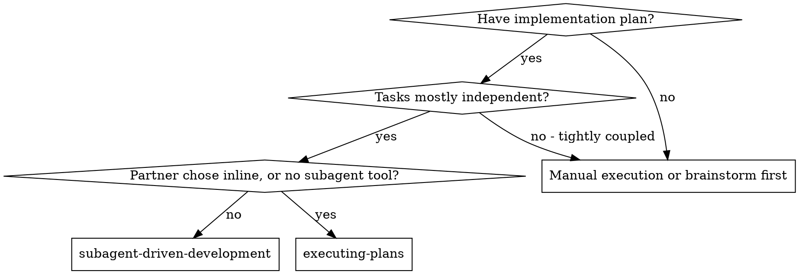
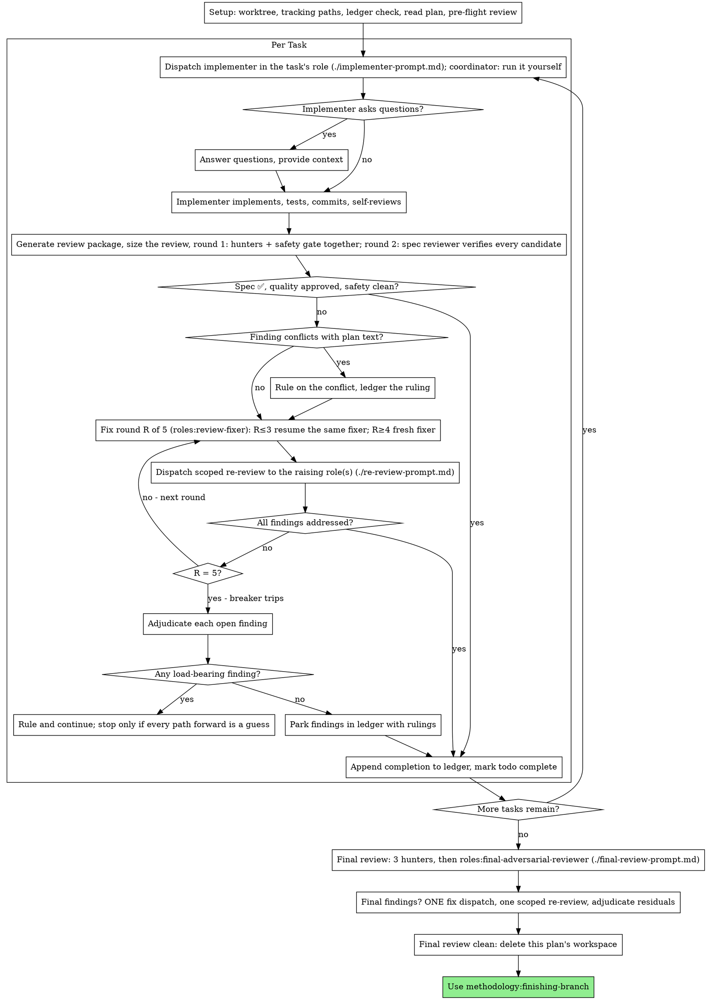

# Subagent-Driven Development

Execute plan by dispatching a fresh implementer subagent per task, in the task's role, a two-round task review after each, and a broad whole-branch review at the end. Round 1 sends Haiku hunters and the Haiku safety gate together; round 2 has the Opus spec reviewer verify every candidate and judge spec compliance and task quality. Every dispatch goes to a `roles:*` agent (see Role Dispatch).

**Why subagents:** You delegate tasks to specialized agents with isolated context. By precisely crafting their instructions and context, you ensure they stay focused and succeed at their task. They should never inherit your session's context or history — you construct exactly what they need. This also preserves your own context for coordination work.

**Core principle:** Fresh subagent per task + two-round task review (hunters + safety in round 1, spec + quality + candidate verification in round 2) + broad final review = high quality, fast iteration

**Narration:** between tool calls, narrate at most one short line — the
ledger and the tool results carry the record.

**Continuous execution:** Do not pause to check in with your human partner between tasks. Execute all tasks from the plan without stopping. The only reasons to stop are the five named below, or all tasks complete. A rate limit is not one of them: ending the run after the bounded wait (see The Task Loop, Rate limits) is not a stop to ask, it is the end of the session, with a final message that lists the ledger's `Ruling:` lines (see Finish), and the ledger keeps the plan resumable. "Should I continue?" prompts and progress summaries waste their time — they asked you to execute the plan, so execute it.

**Rulings, not stalls.** A running plan does not wait on a human. Conflicts,
ambiguities, plan defects, a cap you would have asked to exceed — decide
them. The spec is the binding authority, the plan is its argument, and your
judgment settles what neither answers. Record every decision in the ledger as
`Ruling: <what you decided> — <why> — <what it costs if wrong>`, and keep
going. A wrong ruling costs rework your human partner can see and undo; a
session parked on a question costs their whole day and buys nothing.

Five things stop you, and only these: an irreversible or destructive
operation; a security-sensitive action; a side effect outside this worktree
that norms say you ask about first (a merge, a push to a shared branch, a
publish); a task whose `**Role:**` is not a task role (see Role Dispatch);
and a plan so broken that every path forward is a guess. For those, stop and
ask.

## When to Use



**vs. Executing Plans (inline):**
- Fresh subagent per task (no context pollution) instead of one context doing every task
- Implementation and review in separate roles; inline runs the tasks in this session, and still sends each task to the task review
- Costs a fresh context per task and per review; inline costs one context plus the reviews
- Both run in this session, share the same plan workspace and ledger, and never pause between tasks

## The Process



## Setup

Ensure the work happens in an isolated workspace: use
methodology:using-git-worktrees to create one or verify the existing one.
Never start implementation on a main/master branch without your human
partner's explicit consent.

Conversation memory does not survive compaction. In real sessions,
controllers that lost their place have re-dispatched entire completed task
sequences — the single most expensive failure observed. Track progress in
a ledger file, not only in todos.

- Each plan owns a workspace: at skill start, run this skill's
  `bash scripts/sdd-workspace PLAN_FILE` — it prints the plan's git-ignored
  directory (under `<repo-root>/.methodology/sdd/`, kept out of `git status`
  by `.methodology/.gitignore`), home to every artifact for THIS plan:
  ledger, briefs, reports, review packages. Another plan's directory is
  never yours to read or write.
- Check for this plan's ledger at `<workspace>/sdd-ledger.md`. If its first
  line names your plan file, tasks with a `Task <N>: complete` line are DONE
  — do not re-dispatch them; resume at the first task without one. A task
  whose last line is a fix round is mid-loop: resume the loop at the next
  round. A ledger whose first line names a different plan file is another
  plan's progress: leave it in place and start your own, fresh.
- A plan whose run began before the fork kept its ledger in the old
  workspace. When `sdd-ledger.md` is missing and that old ledger exists
  under this exact plan, `sdd-workspace` copies it once to `sdd-ledger.md`,
  marks the old directory `adopted` (it is never adopted again) and leaves
  it in place; resume from the copy.
- Create the ledger with its identity as the first line:
  `# SDD ledger — plan: <plan file path>`.
- The ledger is your recovery map: the commits it names exist in git even
  when your context no longer remembers creating them. After compaction,
  trust the ledger and `git log` over your own recollection.
- After compaction, when opted in, read `triqual tasks status --json` and the task's `status` in the plan's `*.tasks.json` before your next ledger move, and skip any move the ledger already shows: a `start` or `rework` on a task already `in_progress`, a `review` on one already `in_review`, a `done` on one already `done`. A resumed session never fails on a move it already made. In store mode (`"mode": "store"`) there is no `*.tasks.json` to read: take each task's state from `triqual tasks export --json` (per-task `status`; `triqual tasks status --json` lists only `inProgress` and `next` for each plan), and the entries from `triqual tracking log`.
- `git clean -fdx` will destroy the workspace (it's git-ignored scratch); if
  that happens, recover from `git log`.

### Tracking paths

Run `triqual tasks paths --json` once, before the first dispatch:
- **Opted in** (`"optedIn": true`; an older `triqual` prints the same fields without `optedIn`): the plan's task ledger moves with every task (the `triqual tasks` moves named in The Task Loop, each with `--plan <plan>`: `<plan>` is the plan file in `plansDir` (in store mode its bare file name, see below), so a move never lands on another active plan's ledger), and every implementer and fixer dispatch carries the implementer template's Tracking section, filled with the mode, the `progress` and `status` paths and the plan's `*.tasks.json` in `plansDir`.
- **Not opted in** (`"optedIn": false`, or exit 2 from an older progress-tracking): no ledger moves (run no `triqual tasks` command) and no `progress.md` rules: drop the Tracking section from every dispatch, and never create `progress.md`: creating it opts the repo in and commits a personal log into a shared repo.
- **`triqual` missing** (exit 3, or `triqual` not on `PATH`): handle it as not opted in, and say so once.

Opted in with `"mode": "local"`, the tracking files live under the git dir, which Claude Code protects from agent file writes: your own entries (reviews, rulings, the plan's close) and `status` edits are drafts in the OS temp dir, each under a unique name from `mktemp` (`draft=$(mktemp)`: parallel subagents and sessions share that dir), landed with `triqual tracking write entry <draft>` and `triqual tracking write status <draft>`, and the Tracking section tells implementers and fixers the same. Never write or edit under `.git/` with the file tools.

Opted in with `"mode": "store"` (details: `store-mode.md` under `references` in skill `progress-tracking:progress-tracking`), the tracking lives in the store: `triqual tasks paths --json` has no `progress` or `status` path and there is no `*.tasks.json`, so no tracking file is written, staged or committed (an added or modified `progress.md`, `status.md` or `*.tasks.json` is a defect; the switch's deletions are expected). `<plan>` in every `--plan` is the bare plan file name (for example `2026-10-11-feature.md`), never the `plansDir` path, for the ledger moves and the close only: the check takes no plan option. Fill the implementer template's Tracking section with `"store"` as the mode and drop the three paths. Your own entries (reviews, rulings, the plan's close) are drafts in a private `mktemp -d` dir (`d=$(mktemp -d)`). A task review runs after the implementer's commit already exists, and a ruling, a status-only step or the plan's close ends with no commit of its own, so each of these lands with `triqual tracking add <draft> --no-commit` (or `--commit <reviewed sha>` to record a review against the commit it reviewed), because a pending entry left behind would be stamped onto the next, unrelated commit and would let that commit past the pre-commit gate; only an entry for a commit you are about to make yourself lands with plain `triqual tracking add <draft>` before the commit it describes. Read `status` with `triqual tracking status` and change one section with `triqual tracking status set --section <heading> <draft>`; the whole-file `status set` is only for a full rewrite. Read history with `triqual tracking log`, and ledger state with `triqual tasks status --json` or `triqual tasks export --json`.

The workspace ledger (`sdd-ledger.md`) is kept either way: it is this
skill's recovery map, not a tracking file.

Read the plan once, note its context and Global Constraints, and create a
todo per task. If the plan names a Spec, read that too: the spec is the
authority the plan argues from, and conflicts inside the plan resolve
against it. A plan with no reachable spec gets a ledger note saying so —
rulings made without one are provisional.

Before dispatching Task 1, scan the plan once for conflicts, writing down
what you checked as you check it:

- tasks that contradict each other or the plan's Global Constraints
- anything the plan explicitly mandates that the review rubric treats as a
  defect (a test that asserts nothing, verbatim duplication of a logic block)

The scan's output is a table, not a verdict. One row for every pair of tasks
that share a file or an interface: the two tasks, what one produces against
what the other consumes, and what you found. One row for every task: whether
its own text agrees with itself — the tests it specifies against the code it
specifies, the files it creates against the files it later touches. "The scan
is clean" without those rows is not a scan you ran.

Write the table to the ledger. Rule on everything you find before execution
begins — each finding against the plan text that mandates it — and record
each ruling in the ledger. If the scan is clean, proceed without comment.
Rule on each conflict it surfaces — the spec is the binding authority, the
plan is its argument — record the ruling beside its row, and dispatch
Task 1. The review loop remains the net for conflicts that only emerge from
implementation.

## Role Dispatch

Every dispatch goes to a `roles:*` agent (plugin `roles`), and no dispatch passes a model: each role's definition pins its model and effort, and a model in the dispatch would override that pin. Choose the role; never choose a model.

- **Default:** `bash scripts/task-brief` copies the task's `**Role:**` line into its brief; a task with no `**Role:**` line is `roles:tdd-implementer`, the default.
- **`roles:tdd-implementer`, `roles:complex-implementer` or `roles:review-fixer`:** dispatch [implementer-prompt.md](implementer-prompt.md), with its header's `<task role>` filled with that role, `roles:tdd-implementer`, `roles:complex-implementer` or `roles:review-fixer`. A plan marks a task `roles:complex-implementer` (Opus) for multi-system changes, migrations of live state, or work where a mistake is costly.
- **`coordinator`**: the controller runs the task itself, in this session, with the same ledger moves and the same reviews as a dispatched task. It follows the implementer template's Tracking and Task Skills sections itself and writes the report file the reviewers read.
- **Any other role**, a reviewer role included (`roles:spec-reviewer`, `roles:safety-reviewer`, `roles:hunter`, `roles:final-adversarial-reviewer`, `roles:brief-writer`) or a misspelled one: stop and ask your human partner. Never dispatch it, and never substitute another role for it. The hunter is a review seat of the task review, never a task role.
- **Reviews:** two rounds, never the task's own role. Round 1 sends `roles:hunter` ([hunter-prompt.md](hunter-prompt.md)) and `roles:safety-reviewer` ([safety-review-prompt.md](safety-review-prompt.md)) together; round 2 sends `roles:spec-reviewer` ([task-reviewer-prompt.md](task-reviewer-prompt.md)), which verifies every candidate of round 1.
- **Re-reviews:** the role or roles that raised the findings the fix round addressed ([re-review-prompt.md](re-review-prompt.md)).
- **Fix rounds:** `roles:review-fixer`; for a task whose role is `roles:complex-implementer`, to `roles:complex-implementer` (see The fix loop).
- **Final review:** `roles:final-adversarial-reviewer`, once per branch ([final-review-prompt.md](final-review-prompt.md)).
- **Briefs:** `bash scripts/task-brief` extracts each brief mechanically, at no cost. Dispatch `roles:brief-writer` only when a task's plan text lacks interfaces that must come from the current code.

**Turn count beats token price.** Wall-clock and context cost scale with how
many turns a subagent takes. The role pins the model; what you control is the
dispatch: a brief that carries the exact values, the interfaces the task
touches, and nothing else.

## The Task Loop

**Batch small same-shape work.** When the plan lists several tasks that are
each a small, independent edit of the same kind — the same one-line fix,
constant change, or field addition repeated across files — do not dispatch
one subagent per task. Compose ONE dispatch brief listing every file and
its change, send the whole batch to a single subagent, and review its diff
as one unit. Reserve one-dispatch-per-task for work that needs its own
judgment, its own tests, or its own review surface.

Everything you paste into a dispatch prompt — and everything a subagent
prints back — stays resident in your context for the rest of the session
and is re-read on every later turn. Hand artifacts over as files.

**Waiting on dispatched subagents:** never poll a wait interface with
short timeouts, and never sit in one silent, open-ended wait either.
While you have local work — ledger updates, packaging the next review,
reading reports — keep working; child results arrive on their own.
When you are genuinely idle, wait in bounded stretches (five to ten
minutes, where your platform allows), and between stretches post one
line of status and reconcile your live children: list them, and chase
any that finished without reporting. A bounded stretch keeps nearly
all of a long wait's efficiency while guaranteeing a stuck or lost
child is noticed within minutes, not at the end of the session.

**Rate limits.** A dispatch to any role (an implementer, a fixer or a reviewer, on any model) that is rate-limited mid-plan is not a stop: wait in the bounded stretches above and retry the same dispatch, writing one `RateLimit: <role> <time>` ledger line per stretch, with `<time>` the local time as `HH:MM`. After about 6 stretches without success, end the run with a final message naming the task and listing the ledger's `Ruling:` lines (see Finish); the ledger makes the plan resumable, and that is the end of the session, not a question for your human partner. It never swaps the model in a dispatch: the dispatch keeps the same role and passes no model. A hunter or the safety gate with no Haiku quota is not this case: it is the skip rule (see Review the task, When the stage does not run).

### 1. Dispatch the implementer

Record BASE (`git rev-parse HEAD`) before dispatching — the review package
and fix-round diffs need it.

- **Ledger move:** when opted in, run `triqual tasks start T<N> --plan <plan>` as you dispatch the implementer (or, for a `coordinator` task, as you start it yourself).
- **Role:** read the task's `**Role:**` from its brief and dispatch per Role Dispatch; a role outside the task roles stops you before any dispatch.

- **Task brief:** before dispatching an implementer, run this skill's
  `bash scripts/task-brief PLAN_FILE N` — it extracts the task's full text to a
  uniquely named file and prints the path. Compose the dispatch so the
  brief stays the single source of
  requirements. Your dispatch should contain: (1) one line on where this
  task fits in the project; (2) the brief path, introduced as "read this
  first — it is your requirements, with the exact values to use verbatim";
  (3) interfaces and decisions from earlier tasks that the brief cannot
  know; (4) your resolution of any ambiguity you noticed in the brief;
  (5) the report-file path and report contract; (6) when opted in, the
Tracking section, and when the brief has a `**Skills:**` line, the Task
Skills section (both in the template). Exact values (numbers,
  magic strings, signatures, test cases) appear only in the brief. Never
  make a subagent read the whole plan file.
- **Report file:** name the implementer's report file after the brief
  (brief `…/task-N-brief.md` → report `…/task-N-report.md`) and put it in
  the dispatch prompt. The implementer writes the full report there and
  returns only status, commits, a one-line test summary, and concerns.
- A dispatch prompt describes one task, not the session's history. Do not
  paste accumulated prior-task summaries ("state after Tasks 1-3") into
  later dispatches — a real session's dispatch hit 42k chars of which 99%
  was pasted history. A fresh subagent needs its task, the interfaces it
  touches, and the global constraints. Nothing else.
- The dispatch carries the no-subagents contract (it is in the
  implementer template): the implementer never dispatches subagents —
  not helpers, and never a reviewer. Review arrives from you, after the
  report. In real sessions, every reviewer a worker spawned duplicated
  the task review the controller dispatched anyway — a full extra
  review seat per task.
- If an earlier task parked a finding in the area this task touches, carry
  a pointer to that ledger entry in the dispatch.
- Record the implementer's agent identity from the dispatch result — when
  the task's role is `roles:review-fixer` or `roles:complex-implementer`,
  fix-loop rounds 1-3 resume this agent.
- Never dispatch multiple implementation subagents in parallel (conflicts).

Template: [implementer-prompt.md](implementer-prompt.md)

### 2. Handle the report

Implementer subagents report one of four statuses. Handle each appropriately:

**DONE:** When opted in, run `triqual tasks review T<N> --plan <plan>` when the implementer reports DONE (DONE_WITH_CONCERNS too, once you send it to review). Generate the review package (`bash scripts/review-package PLAN_FILE BASE HEAD`, from this skill's directory — it prints the unique file path it wrote; BASE is the commit you recorded before dispatching the implementer — never `HEAD~1`, which silently drops all but the last commit of a multi-commit task), then run the two-round task review (see Review the task) with the printed path.

**DONE_WITH_CONCERNS:** The implementer completed the work but flagged doubts. Read the concerns before proceeding. If the concerns are about correctness or scope, address them before review. If they're observations (e.g., "this file is getting large"), note them and proceed to review.

**NEEDS_CONTEXT:** The implementer needs information that wasn't provided. Provide the missing context and re-dispatch.

**BLOCKED:** The implementer cannot complete the task. Assess the blocker:
1. If it's a context problem, provide more context and re-dispatch to the same role
2. If the task requires more reasoning than its role brings, break it into smaller pieces or rule on the approach and re-dispatch with the ruling; never override the role's model in the dispatch
3. If the task is too large, break it into smaller pieces
4. If the plan itself is wrong, rule on the correction, ledger it, and re-dispatch with the ruling carried in the dispatch

**Never** ignore an escalation or force the same dispatch to retry without changes. If the implementer said it's stuck, something needs to change.

If the implementer asks questions — before starting or mid-task — answer
clearly and completely, provide additional context if needed, and don't
rush it into implementation.

### 3. Review the task

Per-task reviews are task-scoped gates. The broad review happens once, at the
final whole-branch review. Every task gets a two-round review on one review
package. Round 1 runs together, in the background: Haiku hunters
(`roles:hunter`) look for candidate defects, and `roles:safety-reviewer`
(the gate) runs the safety checklist. Round 2 is `roles:spec-reviewer` with
[task-reviewer-prompt.md](task-reviewer-prompt.md) (spec compliance and task
quality), which also gives a verdict on every candidate. Never skip the task
review (the one exception is a task with no commit range: see When the stage does not run), and never accept a report missing a verdict — spec compliance, task
quality, the safety checklist AND a verdict for every candidate are all
required. Implementer self-review never replaces the task review; both are
needed.

- Hand every reviewer its diff as a file: run this skill's
  `bash scripts/review-package PLAN_FILE BASE HEAD` and pass the reviewer the file path
  it prints (or, without bash: `git log --oneline`, `git diff --stat`,
  and `git diff -U10` for the range, redirected to one uniquely named
  file). The output never enters your own context, and the reviewer sees
  the commit list, stat summary, and full diff with context in one Read
  call. Use the BASE you recorded before dispatching the implementer —
  never `HEAD~1`, which silently truncates multi-commit tasks. Never
  dispatch a task reviewer without a diff file; a hunter is no exception.
- **Reviewer inputs:** the gate and the spec reviewer each get three paths — the same brief
  file, the report file, and the review package — plus the global
  constraints that bind the task. The gate also gets the task's
  canary rules and, when opted in, the tracking files it must expect in the
  diff; the spec reviewer also gets every candidates file. In store mode no tracking file is expected in the diff: the gate is told so, and an added or modified tracking file is a finding. A hunter gets the inputs of [hunter-prompt.md](hunter-prompt.md).
- The global-constraints block you hand the reviewer is its attention
  lens. Copy the binding requirements verbatim from the plan's Global
  Constraints section or the spec: exact values, exact formats, and the
  stated relationships between components ("same layout as X", "matches
  Y"). The reviewer's template already carries the process rules (YAGNI,
  test hygiene, review method) — the constraints block is for what THIS
  project's spec demands.
- Do not add open-ended directives like "check all uses" or "run race tests
  if useful" without a concrete, task-specific reason
- Do not ask a reviewer to re-run tests the implementer already ran on the
  same code — the implementer's report carries the test evidence
- Do not pre-judge findings for the reviewer — never instruct a reviewer to
  ignore or not flag a specific issue. If you believe a finding would be a
  false positive, let the reviewer raise it and adjudicate it in the review
  loop. If the prompt you are writing contains "do not flag," "don't treat X
  as a defect," "at most Minor," or "the plan chose" — stop: you are
  pre-judging, usually to spare yourself a review loop. The same holds for
  candidates: you never tell the verifier how to rule on a candidate, and you
  never drop a hunter's candidate before round 2.

#### Size the review

Before round 1, set the number of hunters from the diff. The references are soft: going over is fine when justified, going over without a reason is not.

| Situation | Reference |
|---|---|
| Diff touches only docs or tracking paths: `docs/`, `README*`, `*.tasks.json`, and when opted in `progress.md` and `status.md` | 0 hunters (the gate still runs) |
| Normal task: any other path, skill markdown included (it is behavior) | 2 hunters: `correctness`, `security` |
| Large (more than about 300 changed lines) or sensitive (I/O, git or subprocess calls, filters, auth, data policy) | up to 4 hunters: all four categories (`correctness`, `security`, `spec-drift`, `state`) |
| Final review | 3 hunters |
| Candidates per hunter | 5 |
| Wait for the hunters after the gate's report (final review: after dispatch) | 10 minutes (final review: 20) |

- "Sensitive" wins over "normal". "Docs only" applies only when no other path changed.
- Every departure from a reference writes one ledger line: `Budget: <what> <reference> → <used> for <T<N>|final> — <reason tied to the diff>`, for example `Budget: hunters 2 → 3 for T3 — the diff reorders the ledger writes, so a state hunter joins correctness and security`.
- The reference "up to 4" is 4: a large or sensitive task records `budget.reference` 4, and sending 3 or 4 hunters is no departure. `overrun` is true only when the used count exceeds the reference.
- Going over twice the reference needs a reason that names something in the diff. "To be thorough" is not a reason.
- The reasons live only in the ledger, never in the store: the record (see Record) carries the reference, the used count and `overrun`, no reason.

#### Round 1

- Dispatch together, in the background, in one message: the N hunters (`roles:hunter`, [hunter-prompt.md](hunter-prompt.md), one per category) and the gate (`roles:safety-reviewer`, [safety-review-prompt.md](safety-review-prompt.md)), each with the printed review package path.
- Wait up to a soft limit of 10 minutes after the gate's report for every hunter still running (final review: 20 minutes from dispatch). One still running at that point is recorded `failed` (timeout), and its output is ignored if it arrives later.
- A hunter that fails, hangs past the wait or returns nothing usable is recorded `failed` for its category, and round 2 goes on with the other candidates. No hunter ever blocks a task.
- Ledger: `Round 1: T<N> — hunters <done>/<sent>, safety ok`. `hunters <done>/<sent>` counts the hunters that returned a usable candidates file, and a valid empty file counts as done, with 0 candidates; `safety ok` means the gate reported, and the gate's findings go to the fix loop after round 2.

#### Round 2

- Dispatch `roles:spec-reviewer` with [task-reviewer-prompt.md](task-reviewer-prompt.md): its usual inputs plus every candidates file of round 1 (the hunters'). It returns its usual review and one verdict per candidate.
- The verdicts are `confirmed` (with a severity), `refuted`, `duplicate-candidate` and `duplicate-review`, as the template defines them. A missing verdict (spec, quality, safety or any candidate) makes the review incomplete: send it back to the reviewer.
- Ledger: `Round 2: T<N> — verdicts <n>/<n>`, the verdicts received over the candidates sent.
- A `confirmed` candidate enters the fix loop like any spec-review finding, at the severity the verifier gave it.

The spec reviewer may report "⚠️ Cannot verify from diff" items — requirements
that live in unchanged code or span tasks. These do not block the rest of the
review, but you must resolve each one yourself before marking the task
complete: you hold the plan and cross-task context the reviewer
lacks. If you confirm an item is a real gap, treat it as a failed spec
review — it enters the fix loop with the other findings.

#### Record

- After round 2, write the record JSON to a file in the workspace and run `triqual role-eval record --plan <plan file> <json-file>`: one `hunters` record per task. `triqual role-eval record` validates the record, exits 2 and names the bad field (never its value), so a mistake costs one re-run. The shape is below; unknown fields are rejected.
- No `safety-shadow` record is written any more: that kind is retired, and `triqual role-eval record` refuses it (exit 2).
- A `hunters` record (one entry per hunter sent; here three hunters, the security one failed, and a departure from the reference 2, as in the `Budget:` example):

```json
{ "v": 1, "at": "2026-10-08T23:10:51Z", "provider": "claude", "task": "T3", "kind": "hunters",
  "hunters": [
    { "category": "correctness", "model": "claude-haiku-5-5", "failed": false, "candidates": 2,
      "confirmed": { "critical": 0, "important": 1, "minor": 0 }, "refuted": 1, "duplicateCandidate": 0, "duplicateReview": 0 },
    { "category": "security", "model": "claude-haiku-5-5", "failed": true, "candidates": 0,
      "confirmed": { "critical": 0, "important": 0, "minor": 0 }, "refuted": 0, "duplicateCandidate": 0, "duplicateReview": 0 },
    { "category": "state", "model": "claude-haiku-5-5", "failed": false, "candidates": 0,
      "confirmed": { "critical": 0, "important": 0, "minor": 0 }, "refuted": 0, "duplicateCandidate": 0, "duplicateReview": 0 }
  ],
  "budget": { "reference": 2, "used": 3, "overrun": true } }
```

- Fields: `provider` is `claude` or `codex`; `task` is `T<N>` or `final`; `at` is the UTC time of the record as ISO 8601 with a trailing `Z`, as in the example; `model` is the model of the role that ran, at the time of the record, never a guess: on Claude the `model:` line of the role's frontmatter in the installed `roles` agent file, on Codex the Codex routing value, the `model` key of `~/.codex/agents/<role>.toml`. A failed hunter carries `"failed": true` and all-zero counts. For each hunter the verdict counts sum to `candidates` (a hunter's `confirmed` summed over its severities); the counts come from the verdicts. `budget` carries the reference, the used count and `overrun`, never the reason. `budget` is required in every `hunters` record you write (the Finish totals sum it), though the validator does not require it.
- `record` derives the idempotency key itself, so a controller resumed after compaction re-runs the command harmlessly: it exits 0 on a write and on `already recorded`.
- A task with 0 hunters still writes a `hunters` record, with `hunters: []` and its budget.
- If `record` fails (exit 2 for a usage or schema error or no git repository, exit 1 for a write or lock failure), or `triqual` lacks `role-eval`, write the record JSON into the workspace ledger as one line, `Unrecorded: <record JSON>`, and continue. Recording it later is a manual `triqual role-eval record` from that line.

#### When the stage does not run

- **No commit range.** `review-package` exits 3 with the message `empty commit range` on an empty range (the coordinator task with no code diff): there is no review package, so no reviewer runs at all: no hunters, no gate and no spec reviewer, and nothing is recorded. Write `Review: T<N> — no commits, nothing to review` to the ledger and complete the task; only the `empty commit range` message means no commits: any other exit 3 (for example `HEAD is not a descendant of BASE`) is an error to fix, never a reason to skip the review.
- **Fix rounds and re-reviews** send no hunters (see The fix loop).
- **Unavailable hunters or Haiku.** When an error arrives before the agent runs (`roles:hunter` is an unknown agent type because the `roles` plugin is older than 0.2.0, the pinned Haiku id is an unresolved model, or there is no quota), skip the hunters and the Haiku gate for the rest of the plan with one ledger line naming the cause, `Skipped: hunters and Haiku gate — <cause>; safety checklist runs in the spec review`. The safety gate is never skipped: its checklist moves into round 2, where `roles:spec-reviewer` runs the safety checklist in the same review, with the gate's inputs (the canary rules and, when opted in, the tracking files), through the Safety Checklist section of [task-reviewer-prompt.md](task-reviewer-prompt.md); its report carries the checklist verdicts and the `Safety:` verdict, with no candidates and no records. Its safety findings are the spec reviewer's findings: they enter the fix loop and its scoped re-review like the rest. `triqual doctor` reports the version skew. After the `Skipped:` line no `Round 1:` line is written for a task, and the spec review is ledgered as before. Look for a `Skipped:` line in the ledger before every round 1, so the skip survives compaction. A run that starts and then fails, hangs or returns nothing usable is not a skip: a gate that starts and then fails is re-dispatched; only hunters are recorded `failed`, each `failed` for that task only (see Round 1). This never fails the task.

Templates: [hunter-prompt.md](hunter-prompt.md), [safety-review-prompt.md](safety-review-prompt.md), [task-reviewer-prompt.md](task-reviewer-prompt.md)

### 4. The fix loop

The loop triggers when the spec review reports spec ❌, either review
reports any Critical or Important finding, round 2 confirms a candidate as
`critical` or `important`, or a ⚠️ item you confirmed as a real gap.

Before the loop starts, two routes leave it immediately:

- Record Minor findings, `minor` confirmed candidates included, in the workspace ledger (`sdd-ledger.md`) as you go
  (`Task <N>: minor (deferred): <one-liner>`), and point the final
  whole-branch review at that list so it can triage which must be fixed
  before merge. A roll-up nobody reads is a silent discard. Minor findings
  never enter the loop.
- A finding labeled plan-mandated — or any finding that conflicts with
  what the plan's text requires — is yours to rule on: weigh the finding
  against the plan text, decide with the spec as the binding authority, and
  ledger the ruling before you act on it. Do not dismiss the finding because
  the plan mandates it, and do not dispatch a fix that contradicts the plan
  without a recorded ruling.
Everything else enters the loop. A confirmed candidate enters it like any spec-review finding. A fix round is one fix dispatch plus one
scoped re-review. Five rounds maximum per task. Fix rounds go to
`roles:review-fixer` (a `roles:complex-implementer` task keeps its role: see
below), which fixes what is real and refutes with evidence what is not:

- **Fix rounds and re-reviews send no hunters.** The round 1 and round 2 reviews run once per task, on the implementer's commits; a fix round is checked by the scoped re-review of the raising role alone.

- **Ledger move:** when opted in, run `triqual tasks rework T<N> --plan <plan>` at the start of each fix round, before the fix dispatch, and `triqual tasks review T<N> --plan <plan>` when the fixer reports back and the re-review starts.
- Every fix dispatch to `roles:review-fixer` (or to `roles:complex-implementer`, for its own task) carries the implementer template's Tracking section when opted in, and its Task Skills section when the brief has a `**Skills:**` line.

**Rounds 1-3 — resume the same `roles:review-fixer`.** Round 1 dispatches
a `roles:review-fixer` with the open findings verbatim, the brief path and
the report-file path; rounds 2 and 3 resume that same fixer, whose context
holds the task, the code and its earlier fixes. When the task's own role is
`roles:review-fixer`, round 1 resumes the implementer instead: it already is
that fixer. If your harness cannot send another message to a live subagent,
dispatch a fresh fixer carrying the brief path, the report-file path, and
the findings — the report file is the persistent memory either way.

**Rounds 4-5 — dispatch a fresh `roles:review-fixer`** each round, with the
brief path, the report-file path, the open findings, and this framing: "A
prior fixer attempted this task [N] times; you own it now. Read the report
file for what was tried." A loop that survives three rounds with one fixer
usually means the fixer cannot see its own problem — fresh eyes in one move.

**A `roles:complex-implementer` task keeps its role in the fix loop.** Its
fix rounds go to `roles:complex-implementer`, never to `roles:review-fixer`:
the work is costly to get wrong, so it stays with the stronger model. Rounds
1-3 resume the implementer itself, whose context holds the task and the
code; rounds 4-5 dispatch a fresh `roles:complex-implementer` each round,
with the brief path, the report-file path, the open findings, and the same
framing: "A prior fixer attempted this task [N] times; you own it now. Read
the report file for what was tried." Everything else about a round is the
same.

**Every round, either way:** the fixer fixes, re-runs the tests
covering the amended code, appends its fix report to the same report file,
and returns the short contract. Before re-dispatching the reviewer, confirm
the fix report contains the covering tests, the command run, and the
output; dispatch the re-review once all three are present. Name the
covering test files in the fix message — a one-line fix does not need the
whole suite.

**The re-review is scoped** and goes to the role or roles that raised the findings the round addressed. Run `bash scripts/review-package PLAN_FILE FIX_BASE HEAD`
where FIX_BASE is the head the previous review saw, and dispatch
[re-review-prompt.md](re-review-prompt.md) to each raising role, with its
own findings, the brief, the report file, and the printed diff path. The re-reviewer verdicts
each finding ADDRESSED or NOT ADDRESSED and flags new breakage in the fix
diff only. New Critical/Important breakage in the fix diff joins the open
findings list. Out-of-scope observations go to the ledger as deferred
minors — they never extend the loop.

**After each round,** append to the ledger:
`Task <N>: fix round <R>/5 (<X> addressed, <Y> open — <finding one-liners>; commits <a7>..<b7>)`

Never fix findings yourself in the controller session — your context stays
clean for coordination, and controller fixes skip review.

**The breaker.** When round 5's re-review still leaves findings open, stop
dispatching. Adjudicate each open finding yourself — you hold the plan and
the cross-task context the reviewer lacks:

- **The reviewer is wrong, or the point is contestable:** park it —
  `Task <N>: parked — <finding> — Ruling: <why the code stands>`. The final
  review sees both sides.
- **Real, but nothing downstream builds on it:** park it the same way, with
  a ruling that says it's real and deferred.
- **Real and load-bearing** — a later task builds on it, or it reveals a
  plan defect: rule on the smallest change that unblocks the dependent work,
  ledger it as `Task <N>: Ruling: <finding> — <what you decided and why>`,
  and carry it into the next task's dispatch. Parking a structural failure
  silently lets every dependent task build on it. Stop only when the defect
  leaves every path forward a guess.

Adjudicate only at the cap. Adjudicating earlier to end a loop is
pre-judging with a different name. Every adjudication is a ledger entry —
a silent discard is forbidden.

### 5. Complete the task

When the review comes back clean — or every open finding is parked with a
ruling at the cap — append the completion line to the ledger in the same
message as your other bookkeeping:

- **Ledger move:** when opted in, run `triqual tasks done T<N> --commit <sha> --plan <plan>` on approval, with `<sha>` the task's last commit (the head the approving review saw).
- The move leaves the task ledger and `status.md` dirty: the next task's commit stages them, and after the last task the closing commit of methodology:finishing-branch carries them.
- In store mode the move leaves no file dirty (the ledger is in the store), so there is nothing to stage.

- `Task <N>: complete (commits <base7>..<head7>, review clean)`
- `Task <N>: complete (commits <base7>..<head7>, <K> parked)` after a
  tripped breaker

Then mark the todo complete and move on. Never move to the next task while
the review has open Critical/Important issues that are neither fixed nor
parked-with-ruling at the cap.

## Final Review

The final whole-branch review gets a package too: run
`bash scripts/review-package PLAN_FILE MERGE_BASE HEAD` (MERGE_BASE = the commit the
branch started from, e.g. `git merge-base main HEAD`) and include the
printed path in the final review dispatch, so the final reviewer reads
one file instead of re-deriving the branch diff with git commands.

First, the final hunters. Dispatch together, in the background, 3 hunters (`roles:hunter`, [hunter-prompt.md](hunter-prompt.md)): `correctness` across tasks, `security` and `spec-drift`, each with the package, the spec and the plan in place of a brief, writing `final-candidates-<category>.md` in the workspace; wait up to a soft limit of 20 minutes from their dispatch, since there is no gate report and the package is the whole branch. A late or failed hunter is recorded `failed`, as in round 1. Ledger: `Round 1: final — hunters <done>/<sent>`. Look for a `Skipped:` line in the ledger before dispatching them; when the stage is skipped (see When the stage does not run), dispatch the final reviewer as before with no candidates.

Then dispatch
`roles:final-adversarial-reviewer` with
[final-review-prompt.md](final-review-prompt.md), filled with the package
path, the plan, the spec, the plan's Review Focus section verbatim, every candidates file of the final hunters, and the
workspace ledger (`sdd-ledger.md`): the reviewer verifies every candidate under the template's verdicts in the same review, and triages its `Ruling:`,
deferred-minor and parked lines, including which must be fixed before merge. A missing verdict sends the review back. Ledger: `Round 2: final — verdicts <n>/<n>`. Record the final hunters like a task's: one `hunters` record with task `final` (see Record), `Unrecorded:` on a failure.

If the final whole-branch review returns findings, dispatch ONE
`roles:review-fixer` with the complete findings list — not one fixer per
finding. Per-finding fixers each rebuild context and re-run suites; a real
session's final-review fix wave cost more than all its tasks combined.
- The fix dispatch carries the implementer template's Tracking section when opted in, like every fixer brief: its `progress.md` entry rule (Stage/task `Plan <topic> · final fix`) and its staging rule.

Then run exactly one scoped re-review of the fix wave by the role that raised the findings, `roles:final-adversarial-reviewer`, with [re-review-prompt.md](re-review-prompt.md)'s prompt
(`bash scripts/review-package PLAN_FILE FIX_BASE HEAD` over the fix range).
Adjudicate any residual findings as in the task loop's breaker: park with
rulings, or rule on the load-bearing ones and ledger what you decided. Only
the five classes above stop you here. There is no second fix wave —
residual load-bearing findings surface to your human partner when
methodology:finishing-branch presents the options.

## Finish

Before you delete anything, collect every ledger line containing `Ruling:` —
preflight rulings, parked findings, breaker adjudications, all of them — into
your final message under "Rulings I made", in the order you made them, each
with what it costs if wrong. The list is exhaustive: if the ledger holds a
ruling, the list holds it. That list is the only place the decisions you
took on your human partner's behalf reach them — they read it and rework
whatever you got wrong. A ruling that dies with the workspace was a decision
made in secret.

Before the totals, and before you delete the workspace, re-run `triqual role-eval record --plan <plan file> <json-file>` for every record that has an `Unrecorded:` line, writing its JSON to a file first; it is idempotent, so `already recorded` is fine. List every record that still fails in your final message under "Unrecorded records", each with its JSON, so your human partner can record them later: the workspace takes the line with it.

Before you delete the workspace, total the review from the ledger. The totals die with it otherwise.

- Actual hunters: the sum of `<sent>` over every `Round 1:` line, the final one included.
- Reference hunters: the sum of `budget.reference` over the `hunters` record JSON files you wrote in the workspace (the final review's included), counting each record once: an `Unrecorded:` line repeats the JSON of its file, so it adds only a record that has no file. Never open a review package for this.

When opted in, the closing `progress.md` entry (written under methodology:finishing-branch) states the hunters' reference total against their actual total.

When the final whole-branch review is clean and its fixes are merged,
delete this plan's workspace (`rm -rf <workspace>`) — the git history is
the record now. Sibling directories belong to other plans; leave them
alone.

Use methodology:finishing-branch.

## Common Rationalizations

| Excuse | Reality |
|--------|---------|
| "Close enough on spec compliance" | Reviewer found spec gaps = not done. Fix or hit the cap and adjudicate — those are the only exits. |
| "I'll fix it myself, dispatching is overhead" | Controller fixes pollute your context and skip review. Resume the fixer. |
| "One more round will converge" | Past the cap, rounds don't converge — the failure is structural. Adjudicate and route. |
| "The reviewer will just find something new anyway" | Scoped re-reviews verify fixes; they cannot wander. New findings on untouched code go to the ledger, not the loop. |
| "This finding is obviously wrong, I'll drop it" | You adjudicate only at the cap, and every ruling is a ledger entry. Silent discards are forbidden. |
| "The fix was small, skip the re-review" | Unreviewed fixes are how regressions land. Every round ends with a scoped re-review. |
| "Reviews slow the loop down" | The loop without reviews is just unverified churn. Reviews are the loop's brakes and steering. |
| "Ledger bookkeeping is overhead" | The ledger is what survives compaction. Controllers without one have re-dispatched entire completed task sequences. |
| "The implementer spawned its own reviewer — free extra assurance" | It's a duplicate seat reviewing the same diff; the task review is the gate. A worker-spawned reviewer is a defect to flag, not rigor. |
| "I'll name a model to be safe" | A model in the dispatch overrides the role's pinned model. Choose the role; pass no model. |
| "The plan says a reviewer role implements this task — close enough" | A reviewer role is never a task role. Stop and ask; never dispatch it. |

## Example Workflow

```
You: I'm using Subagent-Driven Development to execute this plan.

[Setup: worktree verified]
[Tracking: triqual tasks paths --json → opted in, "mode": "committed"]
[Read plan file once: <plansDir>/feature-plan.md]
[Resolve workspace: bash scripts/sdd-workspace <plansDir>/feature-plan.md — no sdd-ledger.md inside, fresh start]
[Create todos for all tasks]

Task 1: Hook installation script (no **Role:** line → roles:tdd-implementer)

[Run task-brief for Task 1; opted in: triqual tasks start T1 --plan <plan>; dispatch roles:tdd-implementer with brief + report paths + context + Tracking section]

Implementer: "Before I begin - should the hook be installed at user or system level?"

You: "User level (~/.config/myapp/hooks/)"

Implementer: [Later]
  - Implemented install-hook command
  - Added tests, 5/5 passing
  - Self-review: Found I missed --force flag, added it
  - Committed, with the task's progress entry (opted in)

[Opted in: triqual tasks review T1 --plan <plan>; run review-package PLAN_FILE BASE HEAD; normal task: 2 hunters. Round 1: dispatch 2 roles:hunter (correctness, security) and roles:safety-reviewer together with the printed path]
Safety reviewer: 1–7 pass. Safety: clean. Hunters: 1 candidate (correctness-1).
[Ledger: Round 1: T1 — hunters 2/2, safety ok]
[Round 2: dispatch roles:spec-reviewer with the brief, the report, the package and both candidates files]
Spec reviewer: Spec ✅ - all requirements met, nothing extra.
  Strengths: Good test coverage, clean. Issues: None. Task quality: Approved.
  correctness-1: refuted — the flag is handled at src/install.js:31.
[Ledger: Round 2: T1 — verdicts 1/1; triqual role-eval record --plan <plan> for the hunters record]

[Opted in: triqual tasks done T1 --commit d4e5f6a --plan <plan>]
[Ledger: Task 1: complete (commits a1b2c3d..d4e5f6a, review clean)]

Task 2: Recovery modes (**Role:** roles:tdd-implementer)

[Run task-brief for Task 2; opted in: triqual tasks start T2 --plan <plan>; dispatch roles:tdd-implementer with brief + report paths + context + Tracking section]

Implementer: [No questions]
  - Added verify/repair modes
  - 8/8 tests passing
  - Committed

[Opted in: triqual tasks review T2 --plan <plan>; run review-package PLAN_FILE BASE HEAD; round 1 and round 2 as for Task 1]
Spec reviewer: Spec ❌:
  - Missing: Progress reporting (spec says "report every 100 items")
  Issues (Important): Magic number (100)
Safety reviewer: Safety: clean.

[Fix round 1 — opted in: triqual tasks rework T2 --plan <plan>; dispatch roles:review-fixer with both findings + Tracking section]
Fixer: Added progress reporting, extracted PROGRESS_INTERVAL constant.
  Re-ran test/recovery.test.js — 10/10 passing. Fix report appended.

[Opted in: triqual tasks review T2 --plan <plan>; run review-package PLAN_FILE FIX_BASE HEAD; dispatch scoped re-review to roles:spec-reviewer, which raised the findings]
Re-reviewer: Missing progress reporting — ADDRESSED (src/recovery.js:41).
  Magic number — ADDRESSED (src/recovery.js:7). New breakage: none.
  Verdict: all findings addressed.

[Ledger: Task 2: fix round 1/5 (2 addressed, 0 open; commits d4e5f6a..b7c8d9e)]
[Opted in: triqual tasks done T2 --commit b7c8d9e --plan <plan>]
[Ledger: Task 2: complete (commits d4e5f6a..b7c8d9e, review clean)]

...

[After all tasks]
[Run review-package PLAN_FILE MERGE_BASE HEAD; dispatch 3 roles:hunter; Ledger: Round 1: final — hunters 3/3; dispatch roles:final-adversarial-reviewer with final-review-prompt.md and their candidates files; Ledger: Round 2: final — verdicts 2/2]
Final reviewer: No confirmed findings. Ledger triage: deferred minors accepted, none block merge. Merge: ready.

[Delete this plan's workspace — the record now lives in git]

Done! Using methodology:finishing-branch.
```

Forked from superpowers 6.4.2 (skills/subagent-driven-development), MIT © Jesse Vincent — see LICENSE-superpowers.
